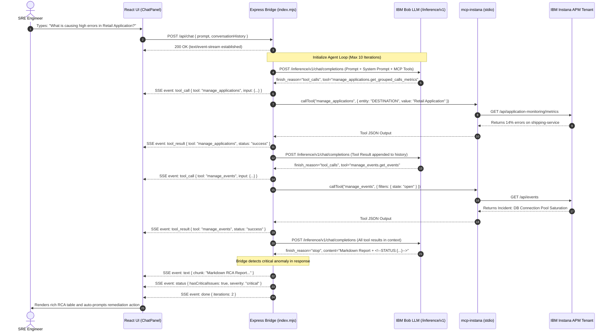

# Autonomous Instana Bob App — Product & Engineering Specification

> **Document Version:** `1.0.0`  
> **Project Identifier:** `autonomous-instana-bob-app` (derived from `instana-bob-app`)  
> **Classification:** Production Architecture & System Specification  
> **Status:** Approved / Reference Standard  

---

## 1. Project Identity & Overview

### 1.1 Purpose & Mission
`autonomous-instana-bob-app` is an autonomous Site Reliability Engineering (SRE) assistant and live observability console. It integrates real-time APM telemetry from **IBM Instana** with the **IBM Bob Inference API** (OpenAI-compatible LLM endpoint) via the **Model Context Protocol (MCP)**.

The application transforms observability from passive graph inspection into active, autonomous problem resolution:
1. **Natural Language Telemetry Querying:** SREs ask plain language questions (e.g., *"What is the erroneous call rate on Retail Application?"*) and receive structured, evidence-backed answers with telemetry tables, latency distributions, and trace evidence.
2. **Autonomous Root Cause Analysis (RCA):** The system continuously detects anomalies and executes multi-step investigation loops, isolating the faulty microservice, infrastructure node, database bottleneck, or cache failure.
3. **Automated Remediation Guidance:** Generates prioritized, step-by-step mitigation plans (configuration changes, rolling restarts, cache warmup, replica scaling).
4. **Dual Stream Architecture:** Provides a zero-dependency offline mode for sales engineering and executive demos alongside a full live production mode connected to live Instana tenants.

---

### 1.2 Dual Stream Modes (`STREAM_MODE`)

The application's runtime data source is governed by the `STREAM_MODE` environment variable:

```
                  ┌──────────────────────────────────────────────┐
                  │                 STREAM_MODE                  │
                  └───────┬──────────────────────────────┬───────┘
                          │                              │
                "mock" (Default)                   "realtime"
                          │                              │
         ┌────────────────┴──────────────┐     ┌────────┴───────────────────────────┐
         │ 🧪 Zero-Credential Simulation │     │ ⚡ Live Enterprise Production       │
         │ - 5 Injectable Scenarios      │     │ - mcp-instana STDIO subprocess     │
         │ - In-Memory Telemetry Engine  │     │ - IBM Bob LLM Tool-Calling Loop    │
         │ - Instant Canned RCA & Chat   │     │ - Real-time Instana Tenant Metrics │
         │ - Works 100% Offline          │     │ - Live Headless Bob Daemon Proxy   │
         └───────────────────────────────┘     └────────────────────────────────────┘
```

| Stream Mode | Purpose | Prerequisites & Credentials | Backend Data Handler |
| :--- | :--- | :--- | :--- |
| **`mock`** *(Default)* | Offline demonstration, CI testing, and UI styling without external dependencies. | **None** (zero credentials needed). | `server/mockRoutes.mjs` + `server/mockData.mjs` |
| **`realtime`** | Live SRE operations across enterprise Kubernetes/OpenShift clusters. | `INSTANA_BASE_URL`<br/>`INSTANA_API_TOKEN`<br/>`BOB_API_KEY`<br/>`BOB_INSTANCE_ID`<br/>`BOB_TEAM_ID` | `server/index.mjs` (MCP Client + Bob OpenAI Client) |

*Note: Any unrecognized `STREAM_MODE` value logs a warning and falls back safely to `mock`.*

---

### 1.3 The 5 Injectable Demo Scenarios

In `mock` mode, the app provides 5 deterministic failure simulations targeting the microservices of the **Retail Application** (`retail-app` namespace on OpenShift):

1. **Scenario 1 — PostgreSQL Connection Pool Exhaustion (`db_pool_exhaustion`):**
   - *Target:* `shipping-service` & `payment-service` on `ocp-worker-02`.
   - *Symptom:* PostgreSQL RDS HikariCP connection pool saturated (10/10 active connections utilized); worker threads blocked on `getConnection()` wait queues exceeding 30,000ms timeouts; 14.0% error rate on `POST /api/v1/shipping/dispatch`; P90 latency climbs from 380ms to 3,420ms.
2. **Scenario 2 — Java JVM Memory Leak & Stop-the-World GC (`jvm_memory_leak`):**
   - *Target:* `payment-service` & `order-service` on `ocp-worker-02`.
   - *Symptom:* Static `PaymentSessionCache` retains unevicted user payment tokens without TTL expiration; Old Gen heap memory hits 96.4%; recurring 4.8s Stop-the-World Major GCs; 16.2% error rate on `POST /api/v1/payment/process`.
3. **Scenario 3 — Redis Cache Stampede & Thundering Herd (`redis_cache_failure`):**
   - *Target:* `cart-service` & `catalog-service` on `ocp-worker-01`.
   - *Symptom:* Simultaneous TTL expiration on high-velocity promotional products; Redis cache hit rate collapses from 98.4% to 28.1%; 12,000 queries/sec flood the backing database; 18.5% error rate on cart additions.
4. **Scenario 4 — 3rd-Party Payment Gateway Rate Limit (`gateway_rate_limit`):**
   - *Target:* `payment-service` on `ocp-worker-02`.
   - *Symptom:* External banking provider returns `HTTP 429 Too Many Requests`; downstream order checkout retries amplify ingress queue depth; 8.4% error rate.
5. **Scenario 5 — Kubernetes CFS CPU Throttling & Eviction (`cpu_throttling_eviction`):**
   - *Target:* `order-service` & `user-auth-service` on `ocp-worker-03`.
   - *Symptom:* Container CPU limit set too strictly (`500m`); Linux Completely Fair Scheduler (CFS) throttles 12.8% of CPU runtime periods; pod memory triggers eviction loop (`OOMKilled` / `CrashLoopBackOff`); P90 latency hits 4,180ms.

---

## 2. Technology Stack & Runtime Prerequisites

### 2.1 Software Stack Specification

```
┌────────────────────────────────────────────────────────────────────────┐
│                              FRONTEND                                  │
│   React 18.3.1  •  Vite 6.0.3  •  @carbon/react 1.71.0 (Carbon v11)   │
│   @carbon/icons-react 11.54.0  •  IBM Plex Sans Typography             │
└───────────────────────────────────┬────────────────────────────────────┘
                                    │ HTTP REST & SSE (/api/*, /hb/*)
┌───────────────────────────────────▼────────────────────────────────────┐
│                           EXPRESS BRIDGE                               │
│   Node.js 20 LTS (ES Modules mjs)  •  Express 4.21.2  •  cors 2.8.5   │
│   @modelcontextprotocol/sdk 1.10.2 •  openai 4.78.0 SDK (Bob Auth)     │
│   http-proxy-middleware 4.2.1      •  dotenv 16.4.7                    │
└───────────────────────┬───────────────────────────────┬────────────────┘
                        │ STDIO JSON-RPC                │ HTTPS /inference/v1
┌───────────────────────▼──────────────┐ ┌──────────────▼────────────────┐
│              MCP LAYER               │ │           AI INFERENCE         │
│  mcp-instana (Python 3.11 Package)   │ │  IBM Bob Inference API        │
│  Executed via uv / uvx               │ │  Model: claude-opus-4-5       │
└───────────────────────┬──────────────┘ └───────────────────────────────┘
                        │ HTTPS REST
┌───────────────────────▼──────────────┐
│           OBSERVABILITY              │
│  IBM Instana APM Enterprise Tenant   │
└──────────────────────────────────────┘
```

### 2.2 Frontend Stack
- **Framework:** React 18.3.1 (Single-Page Application).
- **Build Tool:** Vite 6.0.3 (ESM fast-refresh development server and optimized rollup production build).
- **Design System:** `@carbon/react` (IBM Carbon Design System v11 tokens, themes, grids, and components).
- **Iconography:** `@carbon/icons-react` (standard IBM Carbon icons).
- **Typography:** IBM Plex Sans (`@ibm/plex` font styles imported via Carbon reset).
- **Styling Architecture:** Pure CSS variables with Carbon design tokens (`--cds-background`, `--cds-text-primary`, `--cds-layer-01`, `--cds-support-error`, etc.) in `src/index.css`.

### 2.3 Backend Bridge Stack
- **Runtime:** Node.js 20 LTS (strict native ECMAScript Modules `type: "module"` / `*.mjs`).
- **Web Framework:** Express 4.21.2 with `cors` and `express.json({ limit: '10mb' })`.
- **Model Context Protocol SDK:** `@modelcontextprotocol/sdk` (Stdio client transport connecting to Python MCP server).
- **AI Inference Client:** `openai` Node.js SDK configured with custom IBM Bob authentication headers (`Authorization: Apikey <key>`, `x-instance-id`, `x-team-id`, `User-Agent: bobshell/1.0.6`).
- **Reverse Proxy:** `http-proxy-middleware` for transparently routing `/hb/*` requests to external Headless Bob daemon instances.

### 2.4 MCP & Telemetry Stack
- **Server:** `mcp-instana` (official Instana Model Context Protocol server exposing 11 core APM tools: `manage_applications`, `manage_events`, `manage_infrastructure`, `manage_releases`, `manage_slo`, `manage_synthetics`, `manage_websites`, `manage_automation`, `manage_custom_dashboards`, `manage_maintenance_windows`, `manage_mobile_apps`).
- **Execution Mechanism:** Standard Input/Output (STDIO) subprocess managed by `uv tool` / `uvx` / `python3`.

### 2.5 Containerization & Security Baseline
- **Base Image:** `node:20-bookworm-slim` pinned immutably with SHA-256 digest (`node:20-bookworm-slim@sha256:2cf067cfed83d5ea958367df9f966191a942351a2df77d6f0193e162b5febfc0`).
- **Security Guardrails:**
  - `ENV NODE_ENV=production` declared explicitly across build and runtime stages.
  - Apt package pinning: `python3=3.11.*`, `ca-certificates=2023*`, `curl=7.88.*`.
  - Non-root user execution: `USER node` (UID 1000).
  - Pre-installed MCP binaries in `/opt/uv-tools` to ensure zero runtime network package fetches.
  - Native container healthcheck via `curl -fsS http://127.0.0.1:8080/api/health`.

---

## 3. Architecture & Data Flow

### 3.1 End-to-End System Architecture

```mermaid
flowchart TB
    subgraph Browser ["Frontend Client (React 18 + Carbon v11)"]
        App["App Shell & Navigation (App.jsx)"]
        DT["Digital Twin Topology (DigitalTwinPanel.jsx)"]
        Dash["Application Insights (InsightsDashboard.jsx)"]
        Chat["Autonomous SRE Chat (ChatPanel.jsx)"]
        HB_Panel["Headless Bob Monitor (HeadlessBobPanel.jsx)"]
        ScenarioUI["Scenario Control Drawer (ScenarioControl.jsx)"]
    end

    subgraph BridgeServer ["Express Bridge Server (server/index.mjs :8080)"]
        Dispatcher{"Mode Dispatcher<br/>STREAM_MODE"}
        
        subgraph MockSubsystem ["Mock Engine (STREAM_MODE=mock)"]
            MockRouter["Mock Router (mockRoutes.mjs)"]
            MockDB[("In-Memory State<br/>mockData.mjs")]
        end

        subgraph RealtimeSubsystem ["Realtime Engine (STREAM_MODE=realtime)"]
            AgentLoop["Autonomous Agent Loop<br/>(OpenAI SDK)"]
            MCPClient["MCP Stdio Client<br/>(@modelcontextprotocol/sdk)"]
            InsightsCache[("In-Memory KPI Cache<br/>TTL: 30s")]
            AutoMonitor["Background Monitor Timer<br/>(60s cycle)"]
        end

        HB_Proxy["Headless Bob Proxy (/hb/*)"]
    end

    subgraph ExternalServices ["External Telemetry & AI Services"]
        MCPSubprocess[["mcp-instana Python Subprocess<br/>(stdio)"]]
        InstanaTenant[("IBM Instana Tenant<br/>APM / Metrics / Events")]
        BobInference[["IBM Bob Inference API<br/>https://api.us-east.bob.ibm.com/inference/v1"]]
        HBDaemon[["Headless Bob Daemon Service<br/>(Optional :8000)"]]
    end

    %% Client to Bridge
    App -->|GET /api/health| Dispatcher
    App -->|GET/POST /api/mode| Dispatcher
    DT -->|GET /api/digital-twin| Dispatcher
    Dash -->|GET /api/dashboard, /api/insights| Dispatcher
    Chat -->|POST /api/chat (SSE)| Dispatcher
    ScenarioUI -->|POST /api/demo/*| Dispatcher
    HB_Panel -->|GET /api/monitor/stream (SSE)| Dispatcher
    HB_Panel -->|ALL /hb/*| HB_Proxy

    %% Mode Routing
    Dispatcher -->|STREAM_MODE=mock| MockRouter
    Dispatcher -->|STREAM_MODE=realtime| AgentLoop
    Dispatcher -->|STREAM_MODE=realtime| InsightsCache
    Dispatcher -->|STREAM_MODE=realtime| AutoMonitor

    %% Mock Flow
    MockRouter <--> MockDB

    %% Realtime Flow
    AgentLoop <-->|Tool Definitions & Execution| MCPClient
    AgentLoop <-->|Chat Completion + Tool Calling| BobInference
    InsightsCache <-->|Direct KPI Queries| MCPClient
    AutoMonitor -->|Health Check Prompts| BobInference
    AutoMonitor -->|Fallback Queries| MCPClient

    %% MCP Transport Flow
    MCPClient <==>|STDIO JSON-RPC| MCPSubprocess
    MCPSubprocess <==>|HTTPS REST API / TLS| InstanaTenant

    %% Proxy Flow
    HB_Proxy <==>|HTTP / SSE Forwarding| HBDaemon
```

### 3.2 Real-time Autonomous Agent Chat Sequence



---

## 4. Component & Module Breakdown

### 4.1 Frontend Component Architecture (`src/`)

```
src/
├── main.jsx                     # Application bootstrap, DOM mounting, global index.css import
├── App.jsx                      # Top-level state coordinator: tab switching, health polling, mode sync
├── index.css                    # IBM Carbon theme overrides, responsive grid, status badges, animations
├── assets/
│   ├── instana.png              # Instana product logo
│   └── bob.png                  # IBM Bob avatar / mascot icon
└── components/
    ├── Header.jsx               # Application top bar: logo, title, mode badge (MOCK / REALTIME), health dot
    ├── StatusBar.jsx            # Dynamic telemetry strip: cluster health, active error rate, P90 latency
    ├── Sidebar.jsx              # Collapsible conversation history drawer with session switcher
    ├── DigitalTwinPanel.jsx     # Infrastructure Topology View: OpenShift nodes, gauge cards, pod status
    ├── InsightsDashboard.jsx    # Application Insights View: Golden Signals KPIs, service table, incident list
    ├── ChatPanel.jsx            # Autonomous SRE Chat: conversational stream, auto-scroll, message bubbles
    ├── ChatToolbar.jsx          # Canned suggested prompt chips, clear chat, export conversation JSON
    ├── MessageBubble.jsx        # Markdown renderer with collapsible tool-call execution step accordions
    ├── PromptInput.jsx          # Chat input text box with submit button and keyboard shortcut handlers
    ├── HeadlessBobPanel.jsx     # Autonomous Background Monitor: live SSE log console, start/stop trigger
    ├── ScenarioControl.jsx      # Mock Mode Drawer: 5 failure scenario cards with instant inject / reset
    ├── Icons.jsx                # SVG icon library wrapping Carbon icons and custom mascots
    └── ErrorBoundary.jsx        # Top-level React error boundary preventing white-screen crashes
```

---

### 4.2 Backend Engine Architecture (`server/`)

```
server/
├── index.mjs                    # Central entrypoint: Express server, MCP transport, Bob LLM loop, SSE
├── mockRoutes.mjs               # Express router for all /api endpoints when STREAM_MODE=mock
├── mockData.mjs                 # In-memory store: 5 failure scenarios, baseline telemetry, canned RCA
├── package.json                 # Bridge server dependencies and engine configuration
└── package-lock.json
```

---

## 5. API & Wire Contract Specification

All REST APIs accept and return `application/json` unless otherwise specified. Server-Sent Events endpoints use `text/event-stream`.

### 5.1 System & Mode Management

#### `GET /api/health`
Returns the operational health, active stream mode, and MCP connectivity status.

- **Request:** `GET /api/health`
- **Response Headers:** `Content-Type: application/json`
- **Response Payload (Mock Mode):**
```json
{
  "status": "ok",
  "streamMode": "mock",
  "simulated": true,
  "isLoaded": true,
  "activeScenario": "db_pool_exhaustion",
  "mcpConnected": false,
  "timestamp": 1741000000000
}
```
- **Response Payload (Realtime Mode):**
```json
{
  "status": "ok",
  "streamMode": "realtime",
  "mcpConnected": true,
  "mcpToolsCount": 11,
  "monitoredApp": "Retail Application",
  "bobConfigured": true,
  "timestamp": 1741000000000
}
```

---

#### `GET /api/mode`
Inspects current stream mode configuration.

- **Request:** `GET /api/mode`
- **Response Payload:**
```json
{
  "streamMode": "mock",
  "isMock": true,
  "isRealtime": false,
  "description": "Running in offline demo mode with simulated Retail Application data."
}
```

#### `POST /api/mode`
Switches operational mode at runtime.

- **Request Payload:**
```json
{
  "mode": "realtime"
}
```
- **Response Payload:**
```json
{
  "success": true,
  "previousMode": "mock",
  "currentMode": "realtime",
  "message": "Stream mode updated to realtime."
}
```

---

### 5.2 Autonomous SRE Chat (SSE)

#### `POST /api/chat`
Handles conversational prompts, streams tool execution progress, and streams the final SRE analysis report.

- **Request Headers:** `Content-Type: application/json`
- **Request Payload:**
```json
{
  "prompt": "What is the current health of Retail Application?",
  "conversationHistory": [
    { "role": "user", "content": "Hello" },
    { "role": "assistant", "content": "Hello! I am your Autonomous SRE Assistant." }
  ]
}
```

- **Response Headers:**
  - `Content-Type: text/event-stream`
  - `Cache-Control: no-cache`
  - `Connection: keep-alive`
  - `X-Accel-Buffering: no`

- **SSE Event Stream Sequence:**
```text
data: {"type":"tool_call","tool":"manage_applications","input":{"operation":"get_grouped_calls_metrics","resource_type":"metrics"}}

data: {"type":"tool_result","tool":"manage_applications","status":"success"}

data: {"type":"tool_call","tool":"manage_events","input":{"operation":"get_events"}}

data: {"type":"tool_result","tool":"manage_events","status":"success"}

data: {"type":"text_chunk","chunk":"### 📊 Retail Application Observability Report\n\n"}

data: {"type":"text_chunk","chunk":"| Service | Calls | Errors | Error Rate | P90 Latency |\n|---|---|---|---|---|\n| shipping-service | 42,100 | 5,890 | **14.0%** | 3,420ms |\n"}

data: {"type":"status","hasCriticalIssues":true,"severity":"critical","summary":"PostgreSQL connection pool exhaustion on shipping-service"}

data: {"type":"done","iterations":2}
```

---

### 5.3 Demo Scenario Management (Mock Mode)

#### `GET /api/scenarios`
Lists all available injectable failure scenarios.

- **Request:** `GET /api/scenarios`
- **Response Payload:**
```json
{
  "scenarios": [
    {
      "id": "db_pool_exhaustion",
      "name": "Scenario 1: DB Connection Pool Exhaustion (shipping-service)",
      "shortName": "DB Pool Exhaustion",
      "icon": "🐘",
      "description": "PostgreSQL RDS connection pool saturated (10/10), causing thread contention and 14% HTTP 500 errors.",
      "affectedServices": ["shipping-service", "payment-service"],
      "primaryNodeId": "node-1"
    },
    {
      "id": "jvm_memory_leak",
      "name": "Scenario 2: Java JVM Memory Leak & Stop-the-World GC (payment-service)",
      "shortName": "JVM Memory Leak",
      "icon": "☕",
      "description": "Unbounded heap allocation causes 96% Old Gen memory saturation and 4.8s GC pauses.",
      "affectedServices": ["payment-service", "order-service"],
      "primaryNodeId": "node-1"
    }
  ],
  "activeScenarioId": "db_pool_exhaustion"
}
```

#### `POST /api/demo/load-data` (or `POST /api/scenarios/:id`)
Activates a specific failure scenario.

- **Request Payload:**
```json
{
  "scenarioId": "db_pool_exhaustion"
}
```
- **Response Payload:**
```json
{
  "success": true,
  "loaded": true,
  "activeScenario": "db_pool_exhaustion",
  "scenarioName": "Scenario 1: DB Connection Pool Exhaustion (shipping-service)",
  "affectedServices": ["shipping-service", "payment-service"]
}
```

#### `POST /api/demo/reset-data` (or `POST /api/scenarios/reset`)
Clears injected failures and restores healthy baseline telemetry.

- **Request:** `POST /api/demo/reset-data`
- **Response Payload:**
```json
{
  "success": true,
  "loaded": false,
  "activeScenario": null,
  "message": "Telemetry restored to healthy baseline."
}
```

---

### 5.4 Digital Twin Infrastructure

#### `GET /api/digital-twin`
Returns OpenShift/Kubernetes cluster topology, node resource metrics, and pod statuses.

- **Request:** `GET /api/digital-twin`
- **Response Payload:**
```json
{
  "cluster": {
    "name": "ocp-production-us-south",
    "version": "OpenShift 4.14.18",
    "status": "Degraded",
    "totalNodes": 3,
    "healthyNodes": 2,
    "totalPods": 58
  },
  "nodes": [
    {
      "id": "node-1",
      "name": "ocp-worker-02.retail.internal",
      "ip": "10.240.0.15",
      "zone": "us-south-2",
      "status": "MemoryPressure / DB Lock",
      "metrics": {
        "cpuPercent": 86,
        "memoryPercent": 89,
        "diskPercent": 68,
        "netInMbps": 480,
        "netOutMbps": 520,
        "podsRunning": 24,
        "maxPods": 110
      },
      "pods": [
        {
          "name": "shipping-service-7f8849-c92xa",
          "namespace": "retail-app",
          "status": "Degraded (14% Errors)",
          "restarts": 2,
          "cpuUsage": "84%",
          "memoryUsage": "910 MiB",
          "severity": "critical"
        },
        {
          "name": "payment-service-5d9921-k911a",
          "namespace": "retail-app",
          "status": "Elevated Latency",
          "restarts": 0,
          "cpuUsage": "22%",
          "memoryUsage": "410 MiB",
          "severity": "warning"
        }
      ]
    }
  ]
}
```

---

### 5.5 Application Insights Dashboard

#### `GET /api/dashboard` (and `GET /api/insights`)
Retrieves Golden Signals KPIs, per-service performance breakdown, and active incident lists.

- **Query Parameters:**
  - `window` *(optional, integer)*: Timeframe in milliseconds (e.g. `300000` = 5m, `3600000` = 1h, `86400000` = 24h). Default: `3600000`.
  - `force` *(optional, boolean)*: Set `true` to bypass cache in realtime mode.
- **Response Payload:**
```json
{
  "timeframe": {
    "windowSizeMs": 3600000,
    "from": 1741000000000,
    "to": 1741003600000
  },
  "summary": {
    "totalCalls": 284500,
    "totalErrors": 9920,
    "overallErrorRate": 3.49,
    "topP90LatencyMs": 3420,
    "openIncidentsCount": 1,
    "openIssuesCount": 1
  },
  "services": [
    {
      "name": "shipping-service",
      "calls": 42100,
      "errors": 5890,
      "errorRate": 14.0,
      "p90LatencyMs": 3420,
      "meanLatencyMs": 890,
      "status": "critical"
    },
    {
      "name": "payment-service",
      "calls": 61200,
      "errors": 2940,
      "errorRate": 4.8,
      "p90LatencyMs": 1850,
      "meanLatencyMs": 380,
      "status": "warning"
    },
    {
      "name": "catalog-service",
      "calls": 68900,
      "errors": 210,
      "errorRate": 0.3,
      "p90LatencyMs": 280,
      "meanLatencyMs": 45,
      "status": "ok"
    }
  ],
  "incidents": [
    {
      "id": "inc-retail-8849",
      "title": "shipping-service - High Erroneous Call Rate (14.0%) & DB Connection Pool Saturation",
      "severity": "critical",
      "entity": "shipping-service (retail-app/shipping-service-7f8849)",
      "startTime": 1741003240000,
      "duration": "6 mins"
    }
  ]
}
```

---

### 5.6 Autonomous Background Monitor (Headless Bob)

#### `GET /api/monitor/stream`
Server-Sent Events connection for receiving background health check pulses and autonomous RCA alerts.

- **Response Headers:** `Content-Type: text/event-stream`
- **Events:**
  - `connected`: Initial connection confirmation.
  - `check_start`: Fired when a 60-second polling cycle begins.
  - `status_tick`: Emitted with current severity (`ok`, `warning`, `critical`), error rate, and P90 latency.
  - `alert`: Emitted when an anomaly is detected, containing full autonomous RCA markdown.

#### `POST /api/monitor/register` & `DELETE /api/monitor/register`
Registers or deregisters an external Headless Bob daemon URL and Bearer token.

- **Register Payload:**
```json
{
  "url": "http://127.0.0.1:8000",
  "token": "optional-bearer-token"
}
```

#### `ALL /hb/*`
Transparent reverse proxy routing requests directly to the registered Headless Bob daemon.

---

## 6. Environment Variables & Configuration Matrix

| Variable Name | Required In | Default Value | Description |
| :--- | :--- | :--- | :--- |
| `STREAM_MODE` | All | `mock` | Primary mode switch: `mock` (simulated offline demo) or `realtime` (live Instana). |
| `PORT` | All | `8080` (container) / `3001` (dev) | HTTP port the Express bridge server listens on. |
| `INSTANA_BASE_URL` | `realtime` | *None* | Base URL of your Instana tenant (e.g. `https://instana.example.com`). |
| `INSTANA_API_TOKEN` | `realtime` | *None* | Instana API token with permissions to query metrics, events, and traces. |
| `INSTANA_APP_NAME` | `realtime` | `Retail Application` | Name of the target application perspective monitored in Instana. |
| `BOB_API_BASE_URL` | `realtime` | `https://api.us-east.bob.ibm.com` | Base URL of the IBM Bob Inference API endpoint. |
| `BOB_API_KEY` | `realtime` | *None* | API Key for IBM Bob LLM authorization. |
| `BOB_INSTANCE_ID` | `realtime` | *None* | Cloud instance ID passed via `x-instance-id` header. |
| `BOB_TEAM_ID` | `realtime` | *None* | Team identifier passed via `x-team-id` header. |
| `BOB_MODEL` | `realtime` | `claude-opus-4-5` | Target LLM foundation model used for autonomous tool calling. |
| `INSTANA_MCP_COMMAND` | `realtime` | `uv` / `mcp-instana` | Executable command used to spawn the Instana MCP server. |
| `INSTANA_MCP_ARGS` | `realtime` | `["tool","run","mcp-instana"]` | JSON array of CLI arguments passed to `INSTANA_MCP_COMMAND`. |

---

## 7. Milestone Build & Verification Plan (M0 - M8)

The project is structured for incremental, testable development across 9 distinct milestones:

```
[M0: Scaffolding] ──► [M1: Express Bridge & Mock] ──► [M2: React Shell & Carbon]
                                                              │
[M5: Scenario Engine] ◄── [M4: SRE Chat UI] ◄── [M3: Dashboards & Digital Twin]
         │
         ▼
[M6: Realtime MCP Client] ──► [M7: Bob Agent Loop] ──► [M8: Container & Smoke Tests]
```

### Milestone Summary
- **Milestone M0 — Scaffolding & Manifests:**
  - Create directory layout (`src/`, `server/`, `assets/`, `components/`).
  - Configure root `package.json` (Vite, React, Carbon) and `server/package.json` (Express, MCP SDK, OpenAI SDK).
  - Verify dependency resolution with clean lockfiles.
- **Milestone M1 — Express Bridge & Mock Data Engine:**
  - Implement `server/mockData.mjs` with baseline telemetry and the 5 scenarios.
  - Implement `server/mockRoutes.mjs` with `/api/health`, `/api/scenarios`, `/api/digital-twin`, and `/api/dashboard`.
  - Implement `server/index.mjs` listening on `PORT=3001`.
  - *Verification:* `curl -s http://localhost:3001/api/health | jq .status` returns `"ok"`.
- **Milestone M2 — Vite React UI Shell & Header:**
  - Configure `vite.config.js` with proxy rules routing `/api` and `/hb` to `http://localhost:3001`.
  - Build `Header.jsx`, `StatusBar.jsx`, `Sidebar.jsx`, and `Icons.jsx` with Carbon theme variables.
  - *Verification:* Browser loads UI with functional navigation tabs and green server health indicator.
- **Milestone M3 — Dashboards & Digital Twin Panels:**
  - Build `DigitalTwinPanel.jsx` rendering 3 OpenShift worker nodes with CPU/Memory gauges and pod tables.
  - Build `InsightsDashboard.jsx` rendering KPI cards, service performance bars, and active incident feeds.
  - *Verification:* Switching between Infrastructure and Dashboard tabs updates graphs and metrics.
- **Milestone M4 — Autonomous SRE Chat Interface:**
  - Implement `ChatPanel.jsx`, `ChatToolbar.jsx`, `PromptInput.jsx`, and `MessageBubble.jsx`.
  - Connect to `POST /api/chat` SSE stream with Markdown rendering and tool step expanders.
  - *Verification:* Sending `"Give me the health of Retail Application"` streams a formatted telemetry report.
- **Milestone M5 — Scenario Injection & Dynamic Simulation:**
  - Implement `ScenarioControl.jsx` failure injection drawer.
  - Hook up `/api/demo/load-data` and `/api/demo/reset-data`.
  - *Verification:* Injecting `db_pool_exhaustion` instantly turns `shipping-service` red across Digital Twin, Dashboard, and Chat.
- **Milestone M6 — Realtime MCP Client Integration:**
  - Implement `connectMCP()` using `StdioClientTransport` to spawn `mcp-instana`.
  - Implement `callMCPTool()` and tool schema converter.
  - Implement `/api/insights` live caching layer (30s TTL).
  - *Verification:* `mcpTools.length` reports `11` tools discovered on server startup.
- **Milestone M7 — Bob Inference LLM Agent Loop:**
  - Implement `runAgentLoop()` with OpenAI SDK and custom Bob headers.
  - Implement multi-turn tool calling loop (handling up to 10 iterations).
  - Implement `runHeadlessBobRCA()` and proactive 60-second background monitor.
  - *Verification:* LLM autonomously queries `manage_applications` and `manage_events` before returning answers.
- **Milestone M8 — Production Multi-Stage Containerization:**
  - Create secure `Dockerfile` with multi-stage build (`ui-build`, `bridge-deps`, `runtime`).
  - Pin base images with SHA-256 digests and pin Debian package versions.
  - Declare `USER node` and configure native healthcheck on port `8080`.
  - *Verification:* `docker build` succeeds and container boots cleanly in mock mode.

---

## 8. Acceptance Criteria & Smoke Tests

### 8.1 Automated Smoke Test Script (`smoke-test.sh`)

```bash
#!/usr/bin/env bash
set -euo pipefail

BASE_URL="${1:-http://127.0.0.1:3001}"
echo "======================================================"
echo " Running Autonomous Instana Bob App Smoke Tests"
echo " Target: ${BASE_URL}"
echo "======================================================"

# 1. Healthcheck
echo -n "Checking /api/health ... "
HEALTH=$(curl -sSf "${BASE_URL}/api/health")
STATUS=$(echo "${HEALTH}" | grep -o '"status":"ok"' || true)
if [ -z "${STATUS}" ]; then
  echo "FAIL"
  echo "Response: ${HEALTH}"
  exit 1
fi
echo "PASS (mode: $(echo "${HEALTH}" | grep -o '"streamMode":"[^"]*"' | cut -d'"' -f4))"

# 2. Digital Twin Endpoint
echo -n "Checking /api/digital-twin ... "
TWIN=$(curl -sSf "${BASE_URL}/api/digital-twin")
if echo "${TWIN}" | grep -q '"nodes"'; then
  echo "PASS"
else
  echo "FAIL"
  exit 1
fi

# 3. Application Insights Dashboard Endpoint
echo -n "Checking /api/dashboard ... "
DASH=$(curl -sSf "${BASE_URL}/api/dashboard")
if echo "${DASH}" | grep -q '"services"'; then
  echo "PASS"
else
  echo "FAIL"
  exit 1
fi

# 4. Scenario List Endpoint
echo -n "Checking /api/scenarios ... "
SCENARIOS=$(curl -sSf "${BASE_URL}/api/scenarios")
if echo "${SCENARIOS}" | grep -q '"db_pool_exhaustion"'; then
  echo "PASS"
else
  echo "FAIL"
  exit 1
fi

# 5. Inject Scenario Test
echo -n "Testing Scenario Injection (db_pool_exhaustion) ... "
INJECT=$(curl -sSf -X POST "${BASE_URL}/api/demo/load-data" \
  -H "Content-Type: application/json" \
  -d '{"scenarioId":"db_pool_exhaustion"}')
if echo "${INJECT}" | grep -q '"loaded":true'; then
  echo "PASS"
else
  echo "FAIL"
  exit 1
fi

# 6. Reset Scenario Test
echo -n "Testing Scenario Reset ... "
RESET=$(curl -sSf -X POST "${BASE_URL}/api/demo/reset-data")
if echo "${RESET}" | grep -q '"loaded":false'; then
  echo "PASS"
else
  echo "FAIL"
  exit 1
fi

# 7. SRE Chat SSE Stream Test
echo -n "Testing SRE Chat SSE Stream (/api/chat) ... "
CHAT_STREAM=$(curl -sSf -N -X POST "${BASE_URL}/api/chat" \
  -H "Content-Type: application/json" \
  -d '{"prompt":"health check"}' --max-time 10 | head -n 15)
if echo "${CHAT_STREAM}" | grep -q 'data:'; then
  echo "PASS"
else
  echo "FAIL"
  exit 1
fi

echo "======================================================"
echo " ALL SMOKE TESTS PASSED SUCCESSFULLY!"
echo "======================================================"
```

---

## 9. Security & Production Standards Summary

1. **No Hardcoded Credentials:** All API keys, tokens, and instance IDs are provided strictly via environment variables or Kubernetes/OpenShift Secret mounts.
2. **Strict Telemetry Application Scoping:** The LLM system prompts strictly enforce `application.name = 'Retail Application'` filtering across metrics and incidents to prevent cross-tenant data leakage.
3. **Container Immutability:** Docker builds pin base image SHA-256 digests, apt dependencies, and run under the unprivileged `node` user.
4. **Resilient Offline Fallback:** Missing credentials or network disconnects in `realtime` mode log structured warnings and gracefully fall back to in-memory mock datasets without crashing.
