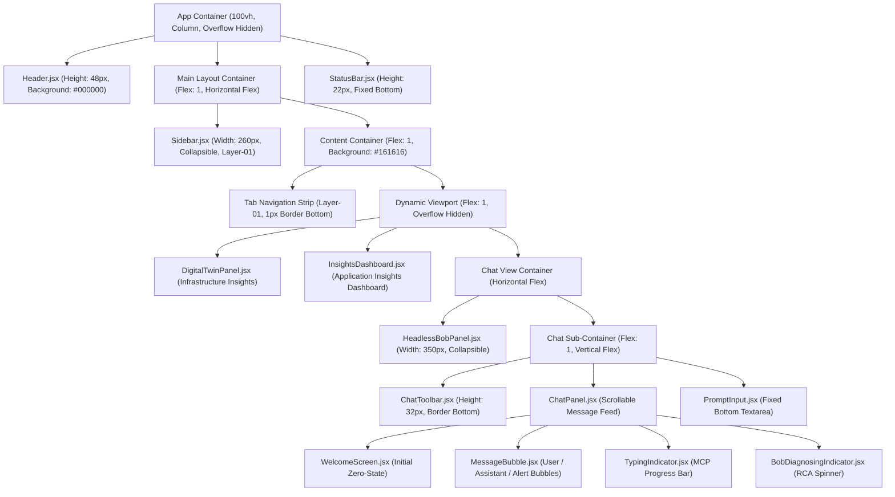
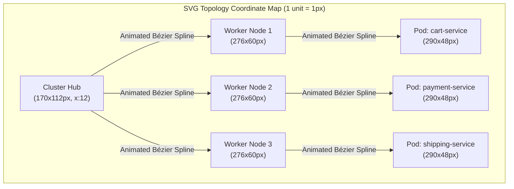

# User Interface Specification: Instana AI Assistant (`instana-bob-app`)

> **Document Type:** UI/UX Specification & Visual Design System Reference  
> **Source Baseline:** `instana-bob-app/src/`  
> **Theme:** IBM Carbon Design System v11 (Dark Theme — Gray 100 / `g100`)  
> **Classification:** Authoritative UI Component & Visual Reference Standard  

---

## 1. Executive Summary & UI Purpose

The **Instana AI Assistant (`instana-bob-app`)** is an autonomous Site Reliability Engineering (SRE) console and observability dashboard. It provides a real-time conversational interface, interactive Kubernetes/OpenShift infrastructure topology visualization, and APM microservice performance metrics.

The interface is built using **React 18** and **Vite 6**, styled strictly to the **IBM Carbon Design System v11 Gray 100 (`g100`) dark theme** token specifications with **IBM Plex Sans** and **IBM Plex Mono** typography.

```
┌──────────────────────────────────────────────────────────────────────────────────┐
│ HEADER: 48px #000000 — Menu Toggle • App Title • Headless Bob Toggle • Mode Pill  │
├──────────────┬───────────────────────────────────────────────────────────────────┤
│ SIDEBAR      │ MAIN CONTENT AREA (Tab Navigation + Active View)                  │
│ 260px        ├───────────────────────────────────────────────────────────────────┤
│ Layer-01     │ TAB BAR: ☸️ Infrastructure • 📊 Application • 🤖 SRE Chat          │
│              ├───────────────────────────────────────────────────────────────────┤
│ New Chat     │ Active View:                                                      │
│ Recent Chats │ 1. Digital Twin Panel (SVG Cluster Topology + Node Telemetry)     │
│ Quick        │ 2. Insights Dashboard (KPI Cards + Service Table + Incidents)     │
│ Prompts      │ 3. Autonomous SRE Chat (Headless Bob Column + Chat Feed + Input)  │
├──────────────┴───────────────────────────────────────────────────────────────────┤
│ STATUS BAR: 22px — Connection Status • Active Host • Model ID • Message Counter  │
└──────────────────────────────────────────────────────────────────────────────────┘
```

---

## 2. Global Layout & Page Anatomy

The application viewport is constrained to a fixed 100% viewport height (`100vh`) with hidden outer overflow to prevent window scrolling. Internal panels feature dedicated custom scrollbars.

### 2.1 Visual Hierarchy & Component Tree



---

## 3. Design System, Color Tokens & Palette

The user interface adheres to IBM Carbon Gray 100 (`g100`) dark theme tokens defined as CSS Custom Properties in `src/index.css`.

### 3.1 Carbon Design System Token Reference Table

| CSS Custom Property | Exact HEX / RGBA Value | Semantic Usage in UI |
| :--- | :--- | :--- |
| `--cds-background` | `#161616` | Global page background, Digital Twin canvas backing. |
| `--cds-background-hover` | `#1e1e1e` | Hover background for icon buttons and navigation elements. |
| `--cds-background-selected` | `#262626` | Selected session background in Sidebar. |
| `--cds-layer-01` | `#262626` | Secondary surfaces, Sidebar, Cards, Tab Bar, Toolbar. |
| `--cds-layer-02` | `#393939` | Nested containers, code block backgrounds, table headers, gauges. |
| `--cds-layer-03` | `#525252` | Scrollbar thumb background, deep nested layers. |
| `--cds-layer-hover-01` | `#333333` | Hover state for table rows, sidebar items, scenario options. |
| `--cds-border-subtle-01` | `#393939` | Card borders, horizontal dividers, table grid lines. |
| `--cds-border-subtle-02` | `#525252` | Selected card borders, input container resting border. |
| `--cds-border-strong-01` | `#6f6f6f` | High-contrast borders, scrollbar hover, prompt card hover. |
| `--cds-text-primary` | `#f4f4f4` | Primary headers, active values, user input text. |
| `--cds-text-secondary` | `#c6c6c6` | Body paragraphs, metric labels, inactive tabs, timestamps. |
| `--cds-text-placeholder` | `#6f6f6f` | Input placeholder text, disabled text, secondary metadata. |
| `--cds-text-disabled` | `#525252` | Disabled button icons, inactive indicator states. |
| `--cds-text-on-color` | `#ffffff` | Text rendered on solid primary blue buttons and badges. |
| `--cds-icon-primary` | `#f4f4f4` | Top-level navigation and system icons. |
| `--cds-icon-secondary` | `#c6c6c6` | Secondary icon buttons, status indicators. |
| `--cds-interactive` | `#4589ff` | Focus rings, text selection, blockquote borders. |
| `--cds-link-primary` | `#78a9ff` | Hyperlinks inside markdown responses, active sub-titles. |
| `--cds-link-primary-hover` | `#a6c8ff` | Hover state for hyperlinks inside markdown responses. |
| `--cds-button-primary` | `#0f62fe` | Primary action buttons, active tab indicators, user chat bubbles. |
| `--cds-button-primary-hover`| `#0050e6` | Hover state for primary action buttons. |
| `--cds-button-primary-active`| `#002d9c`| Active/pressed state for primary action buttons. |
| `--cds-button-disabled` | `#525252` | Disabled submit and action buttons. |
| `--cds-field-01` | `#262626` | Textarea and input container resting fill. |
| `--cds-field-hover-01` | `#333333` | Hover fill for input elements. |

### 3.2 Semantic Status & Severity Colors

| Severity Level | Color Code | Background Fill | Border Style | Badge / Text Display |
| :--- | :--- | :--- | :--- | :--- |
| **Critical / Error** | `#da1e28` / `#ff8389` | `#2d0709` (`rgba(218, 30, 40, 0.12)`) | `1px solid #da1e28` | `🔴 Critical` / `🔴 CRITICAL ALERT` |
| **Warning** | `#f1c21b` | `#1c1500` (`#2d1f00`) | `1px solid #f1c21b` | `🟡 Warning` / `🟡 WARNING` |
| **Healthy / OK** | `#24a148` / `#42be65` | `#071908` (`rgba(36, 161, 72, 0.15)`) | `1px solid #24a148` | `✅ Healthy` / `✅ OK` |
| **Informational / Blue** | `#0f62fe` / `#4589ff` | `#001141` (`rgba(15, 98, 254, 0.15)`) | `1px solid #0f62fe` | `🔵 Info` / `GenAI Engine` |
| **Mock Simulation** | `#f1c21b` (Yellow) | `#f1c21b` (Gold solid badge) | `1px dashed #f1c21b` | `MOCK DATA` (Dark text `#161616`) |

---

## 4. Typography & Text Hierarchy

Typography is governed by IBM Carbon standard font pairings loaded via Google Fonts in `index.html`:
- **Primary Font Family:** `'IBM Plex Sans', -apple-system, BlinkMacSystemFont, sans-serif`
- **Monospace Font Family:** `'IBM Plex Mono', 'Courier New', monospace`

### 4.1 Typography Scale Table

| UI Element | Font Family | Size | Weight | Line Height | Color |
| :--- | :--- | :--- | :--- | :--- | :--- |
| **App Title** | `IBM Plex Sans` | `15px` (`0.95rem`) | `600` (Semi-Bold) | `1.3` | `#ffffff` |
| **Section Headings (H1)** | `IBM Plex Sans` | `24px` (`1.5rem`) | `300` (Light) | `1.2` | `#f4f4f4` |
| **Card / Panel Titles (H2)**| `IBM Plex Sans` | `15px` | `600` (Semi-Bold) | `1.3` | `#f4f4f4` |
| **Subheadings (H3)** | `IBM Plex Sans` | `13px` | `600` (Semi-Bold) | `1.4` | `#f4f4f4` |
| **KPI Big Numbers** | `IBM Plex Sans` | `26px` | `300` (Light) | `1.0` (tabular) | Dynamic / `#f4f4f4` |
| **Body Paragraphs** | `IBM Plex Sans` | `14px` (`0.875rem`) | `400` (Regular) | `1.5` – `1.6` | `#c6c6c6` |
| **Tab Navigation Labels** | `IBM Plex Sans` | `13px` | `400` / `600` | `1.0` | `#c6c6c6` / `#0f62fe` |
| **Table Header Cells** | `IBM Plex Sans` | `12px` | `600` (Semi-Bold) | `1.2` | `#c6c6c6` |
| **Table Data Cells** | `IBM Plex Sans` | `12px` | `400` / `500` | `1.4` (tabular) | `#f4f4f4` / `#c6c6c6` |
| **Code Spans (`<code>`)** | `IBM Plex Mono` | `11.5px` (`0.82rem`)| `400` (Regular) | `1.0` | `#78a9ff` / `#a8c7fa` |
| **Tool Parameters / Logs**| `IBM Plex Mono` | `10px` – `11px` | `400` (Regular) | `1.3` | `#78a9ff` / `#6f6f6f` |
| **Status Bar Metrics** | `IBM Plex Mono` | `9.5px` (`0.68rem`) | `400` (Regular) | `1.0` | `rgba(255,255,255,0.85)`|
| **Metadata / Timestamps** | `IBM Plex Sans` | `11px` (`0.68rem`) | `400` (Regular) | `1.0` | `#6f6f6f` |
| **Badges & Severity Pills**| `IBM Plex Sans` | `10px` | `700` (Bold) | `1.0` | `#ffffff` / `#161616` |

---

## 5. Layout Anatomy & Component Specifications

### 5.1 Global Header (`src/components/Header.jsx`)
- **Dimensions:** Fixed height `48px`, full width (`100%`), `z-index: 100`, `flexShrink: 0`.
- **Background:** `#000000` (Solid Black), border bottom `1px solid var(--cds-border-subtle-01)` (`#393939`).
- **Internal Elements (Left to Right):**
  1. **Sidebar Toggle Button:** `20x20px` SVG hamburger icon (transitions to an X when open), hover background `#1e1e1e`.
  2. **Product Logo:** 26px `InstanaMcpIcon` (rendered from `assets/instana.png`).
  3. **Title Text Group:**
     - `"IBM Instana Observability"`: White (`#ffffff`), `13px`, Weight `600`.
     - Divider `"|"`: `#c6c6c6`, Weight `300`.
     - `"Autonomous SRE Platform"`: `#78a9ff`, Weight `500`.
     - Badge `"GENAI SRE ENGINE"`: Monospace, `9px`, Weight `600`, background `rgba(15, 98, 254, 0.2)`, border `1px solid rgba(15, 98, 254, 0.4)`, color `#a6c8ff`.
  4. **Headless Bob Panel Toggle Button (Visible only on Chat Tab):**
     - Background: `rgba(15, 98, 254, 0.2)` when active, border `rgba(15, 98, 254, 0.6)`.
     - Label: `"Contract Bob Panel"` or `"Expand Bob Panel"`.
  5. **Stream Mode Status Pill:**
     - **Mock Mode:** Background `rgba(241, 194, 27, 0.12)`, border `#8e6a00`, text `#f1c21b`, label `"MOCK DATA"`, `6px` pulsing yellow dot.
     - **Realtime Mode (Connected):** Background `#071908`, border `#0e4e2a`, text `#42be65`, label `"Instana MCP · 11 tools"`, `6px` green dot.
     - **Realtime Mode (Disconnected):** Background `#2d0709`, border `#5a1e22`, text `#ff8389`, label `"MCP Disconnected"`, `6px` red dot.

---

### 5.2 Global Status Bar (`src/components/StatusBar.jsx`)
- **Dimensions:** Fixed height `22px`, full width (`100%`), fixed to viewport bottom.
- **Background State Colors:**
  - Connecting / Pending: `#393939`
  - Mock Mode: `#8e6a00` (Dark Mustard Amber)
  - Realtime Connected: `#0f62fe` (Carbon Interactive Blue)
  - Disconnected / Error: `#6f1d1d` (Dark Red)
- **Typography:** `IBM Plex Mono`, `9.5px` (`0.68rem`), letter spacing `0.02em`, color `rgba(255,255,255,0.85)`.
- **Data Sections (Left to Right):**
  1. Connection Indicator: `5px` round colored dot + status string (`"STREAM_MODE=mock · mock data"` or `"MCP Connected · 11 tools"`).
  2. Active Instana Tenant Endpoint (Realtime only, e.g., `"⬡ instana.example.com"`).
  3. Active LLM Foundation Model (Realtime only, e.g., `"◆ claude-opus-4-5"`).
  4. Conversation Message Counter (`"N messages"`).
  5. Branding: `"Instana AI · Bob Inference · MCP"`.

---

### 5.3 Sidebar Navigation (`src/components/Sidebar.jsx`)
- **Dimensions:** Fixed width `260px`, height `calc(100vh - 70px)`, border right `1px solid #393939`, background `var(--cds-layer-01)` (`#262626`).
- **Internal Elements:**
  1. **New Conversation Button:**
     - Width `100%`, height `36px`, background `#0f62fe`, hover `#0050e6`, text `#ffffff`, border radius `2px`.
     - Icon: 16px Plus SVG.
  2. **Recent Chat Sessions List:**
     - Section Header: `"RECENT"` (`10px`, weight `600`, text-transform uppercase, color `#c6c6c6`).
     - Session Item Button: Active background `#262626` (selected) with `1px solid #525252`, hover background `#333333`.
     - Title: `11px`, single-line text ellipsis overflow.
     - Subtitle: Formatted time (`09:41 AM`), `9.5px`, color `#6f6f6f`.
  3. **Quick Prompts Shelf:**
     - Section Header: Lightning SVG + `"QUICK PROMPTS"`.
     - Prompt Buttons: Border `1px solid #393939`, background transparent, hover background `#333333`, hover border `#6f6f6f`, hover text `#f4f4f4`, font size `11px`, line height `1.4`.

---

### 5.4 Primary Tab Bar Navigation (`src/App.jsx`)
- **Container:** Full width, height `40px`, background `var(--cds-layer-01)` (`#262626`), border bottom `1px solid #393939`.
- **Tab Buttons:**
  - `☸️ Infrastructure Insights` (`id: 'infrastructure'`)
  - `📊 Application Insights Dashboard` (`id: 'dashboard'`)
  - `🤖 Autonomous SRE Chat` (`id: 'chat'`)
- **Styling Rules:**
  - Active Tab: Bottom border `2px solid #0f62fe`, text `#0f62fe`, weight `600`.
  - Inactive Tab: Bottom border `2px solid transparent`, text `#c6c6c6`, weight `400`.
  - Hover: Text color transitions to `#f4f4f4`.

---

### 5.5 Infrastructure Insights (`src/components/DigitalTwinPanel.jsx`)

#### 1. Header Toolbar
- Title: `15px`, weight `600`, with icon `☸️`.
- Cluster Status Indicator: Pulsing pill (`HEALTHY` in `#24a148` or `CRITICAL` in `#da1e28` with keyframe glow animation).
- Cluster Selector Dropdown: Native select element, background `#393939`, text `#f4f4f4`, border `1px solid #393939`.
- Manual Refresh Button: 32x32px square button with reload glyph `↻`.

#### 2. Interactive SVG Cluster Topology
- **Dimensions:** Width matches container (minimum `900px`), height dynamically calculated (`Math.max(200, ...)`).
- **Visual Encoding:**
  - **Cluster Hub (Left Column, `x: 12`, `w: 170`, `h: 112`):** Rounded rectangle (`rx: 8`), fill `var(--cds-layer-01)`, stroke `var(--cds-border-subtle-01)`.
  - **Worker Nodes (Center Column, `w: 276`, `h: 60`):** Rounded rectangle (`rx: 6`), hover fill `#333333`, focus-visible stroke `#ffffff` with stroke-width `3`. Features colored severity indicator ring and real-time CPU/Mem metrics.
  - **Hosted Pods (Right Column, `w: 290`, `h: 48`):** Rounded rectangles displaying microservice pod names, namespace, and container restart counters.
  - **Animated Connection Splines:** SVG Bézier curves connecting Cluster -> Nodes -> Pods. Features animated stroke dashflow (`animation: flow-dash-normal 2s linear infinite`).



#### 3. Worker Node Detail Telemetry Card
- **Circular Resource Gauges (`CircularGauge`):**
  - Dimensions: `80px` diameter, stroke-width `7px`.
  - Color Transition: `<65%` = Green (`#24a148`), `65%-80%` = Yellow (`#f1c21b`), `>80%` = Red (`#da1e28`).
  - Drop Shadow: `drop-shadow(0 0 5px ${color}88)`.
  - Displays: **CPU requested**, **Memory requested**, **Pod allocation**.
- **Linear Resource Bars (`AnimatedBar`):**
  - Height `6px`, background `#2c2c2c`, border-radius `3px`.
  - Displays **CPU limits vs allocatable** and **Disk IOPS**.
- **Open Instana Issues List:**
  - Cards with left border `3px solid ${severityColor}`, background `#393939`, suggestion text in secondary grey.
- **Action Button:**
  - `"🤖 Ask Autonomous SRE Agent to Diagnose <node-name>"`: Full width, height `38px`, background `#0f62fe`, hover `#0050e6`, text `#ffffff`, weight `600`.

---

### 5.6 Application Insights Dashboard (`src/components/InsightsDashboard.jsx`)

#### 1. Top KPI Summary Cards (`KpiCard`)
Grid layout with `gap: 10px`, min-width `140px`, flex `1 1 140px`.

```
┌─────────────────┬─────────────────┬─────────────────┬─────────────────┬─────────────────┬─────────────────┐
│ TOTAL CALLS     │ TOTAL ERRORS    │ ERROR RATE      │ TOP P90 LATENCY │ OPEN INCIDENTS  │ OPEN ISSUES     │
│ 284,500         │ 9,920           │ 3.49%           │ 3,420 ms        │ 1               │ 1               │
│ [Primary White] │ [Critical Red]  │ [🟡 Warning]    │ [Critical Red]  │ [Critical Red]  │ [🟡 Warning]    │
└─────────────────┴─────────────────┴─────────────────┴─────────────────┴─────────────────┴─────────────────┘
```

#### 2. Time Window Selector Strip
- Button group with 5 timeframes: `5m` (300,000ms), `15m` (900,000ms), `1h` (3,600,000ms), `3h` (10,800,000ms), `24h` (86,400,000ms).
- Active item styled in `#0f62fe` with white text.
- Cooldown countdown badge: `"⏳ Cooldown (42s)"` rendered when Instana API rate limit is active.

#### 3. Microservices Performance Table (`ServiceTable`)
- Table columns: `Service`, `Calls`, `Volume` (with `MiniBar` visualizer), `Errors`, `Error Rate`, `P90 Latency`, `Mean Latency`.
- Error rates highlighted: `>=10%` = `#da1e28` (Bold), `3%-10%` = `#f1c21b`, `<3%` = `#24a148`.
- Row hover state: Background `#333333`.

#### 4. Incidents & Issues Split Feeds (`EventList`)
- Side-by-side flex containers (`flex: 1`).
- Card layout with severity pill (`🔴 Critical`, `🟡 Warning`, `🔵 Info`), relative timestamp (`"6m ago"`), and direct `"🤖 Investigate"` action button.

---

### 5.7 Autonomous SRE Chat Interface (`src/components/ChatPanel.jsx`)

#### 1. Zero-State Welcome Screen
- Center-aligned container (`max-width: 480px`).
- Circular Mascot Badge: `64x64px`, radial gradient background `linear-gradient(135deg, rgba(15,98,254,0.2) 0%, rgba(0,45,156,0.35) 100%)`, box-shadow `0 0 20px rgba(15, 98, 254, 0.3)`.
- Suggested Prompt Cards: 2x2 CSS Grid (`gap: 0.75rem`), background `#262626`, hover background `#333333`, hover border `#6f6f6f`.

#### 2. Message Bubbles (`src/components/MessageBubble.jsx`)
- **User Bubble:** Right-aligned, max-width `72%`, background `#0f62fe`, text `#ffffff`, border-radius `4px 4px 0 4px`.
- **Assistant Telemetry Bubble:**
  - Left-aligned, avatar: 28px `InstanaMcpIcon`.
  - Header: `"Instana Assistant"` (`12px`, weight `600`), step counter (`"2 steps"` in monospace pill), timestamp.
  - Tool Execution Badge (`ToolCallsBadge`): Accordion button (`"2 tool calls ▾"`), expandable to show MCP tool names and JSON parameter payloads.
  - Markdown Body: Custom renderer supporting headings, lists, inline monospace code, syntax-highlighted code blocks, blockquotes, and tables.
- **Headless Bob Autonomous Alert Card:**
  - Avatar: 32px circular Bob Robot Mascot (`BobAvatar`).
  - Title: `"Headless Bob — Autonomous Alert"`.
  - Severity Tag: `🔴 CRITICAL ALERT` (Red background `#da1e28`) or `🟡 WARNING` (Amber `#f1c21b`).
  - Container Border: Left accent bar `4px solid #da1e28` (or `#f1c21b`), background `rgba(218, 30, 40, 0.08)`.
  - CTA Button: `"🔍 Investigate Root Cause in Chat"` (styled with `#0f62fe` border).

#### 3. Typing & Progress Indicators
- **`TypingIndicator`:** 3 pulsing blue dots (`#4589ff`) with rotating text:
  1. `"⚡ Connecting to Instana MCP server…"`
  2. `"🔧 Selecting Instana MCP tools for your question…"`
  3. `"📊 Querying Instana telemetry…"`
  4. `"⚙️ Correlating results and writing the report…"`
- **`BobDiagnosingIndicator`:** Pulsing red dot (`#da1e28`) with blue-bordered card and rotating text:
  1. `"🤖 Headless Bob: reviewing the Instana findings…"`
  2. `"🤖 Headless Bob: correlating evidence and dependencies…"`
  3. `"🤖 Headless Bob: drafting Root Cause Analysis (RCA) & remediation plan…"`

---

### 5.8 Prompt Input Bar (`src/components/PromptInput.jsx`)
- **Container:** Fixed bottom dock, background `var(--cds-layer-01)` (`#262626`), border top `1px solid #393939`, padding `12px 24px 16px`.
- **Input Field:**
  - Auto-resizing textarea: Height expands from `24px` to `180px` based on content (`Math.min(scrollHeight, 180)`).
  - Background: `var(--cds-field-01)` (`#262626`), border `1px solid #525252`, focus border `1px solid #4589ff`.
  - Placeholder: Auto-rotates through 4 example prompts every 4,000ms.
- **Send Button:**
  - Dimensions: `36px` width, `32px` height, border radius `2px`.
  - Active: Background `#0f62fe`, hover `#0050e6`, text `#ffffff`.
  - Disabled / Loading: Background `#525252`, text `#6f6f6f`, cursor `not-allowed`.
  - Loading State: Animated SVG circular spinner.
- **Keyboard Shortcut Helper:**
  - Footnote: `"Press Enter to send · Shift+Enter for new line"`.
  - Character counter: Displays `"<N> chars"` dynamically.

---

### 5.9 Headless Bob Autonomous Monitor Column (`src/components/HeadlessBobPanel.jsx`)
- **Dimensions:** Width `350px` (min `320px`, max `420px`), full height, border right `1px solid #393939`, background `var(--cds-layer-01)`.
- **Collapsed Tab Bar Variant:** Contracted to a `46px` slim bar with vertical text `"HEADLESS BOB SRE"` and circular avatar badge.
- **Internal Panels:**
  1. **Autonomous Alerts Feed (`AlertCard`):** Collapsible alert cards with color-coded left borders, severity badges, error rate percentages, and P90 latency meters.
  2. **Manual Investigation History (`RunCard`):** Displays previous LLM diagnostic thread runs with token consumption metrics (`usage.total_tokens`).
  3. **Connection Controls:** URL input (`http://127.0.0.1:8000`), optional Bearer token field, Connect / Disconnect actions.
  4. **Auto-Monitor Controls:** Start / Stop auto-monitor toggle button connected to `/api/monitor/stream`.

---

### 5.10 Mock Scenario Injection Drawer (`src/components/ScenarioControl.jsx`)
- **Visibility:** Rendered ONLY when `STREAM_MODE=mock`.
- **Trigger Button:** `"🧪 Select SRE Anomaly Scenario ▾"` (Border `1px solid #0f62fe`, background `rgba(15,98,254,0.12)`, text `#78a9ff`, font-weight `600`).
- **Dropdown Listbox:** Absolute positioning (`top: 100%`, `z-index: 50`, `width: 380px`), background `#262626`, shadow `0 4px 16px rgba(0,0,0,0.5)`.
- **Scenario Cards:**
  1. `🐘 DB Connection Pool Exhaustion (shipping-service)`
  2. `☕ Java JVM Memory Leak & Stop-the-World GC (payment-service)`
  3. `⚡ Redis Cache Stampede & Thundering Herd (cart-service)`
  4. `💳 3rd-Party Payment Gateway Rate Limit (payment-service)`
  5. `☸️ Kubernetes CFS CPU Throttling & Pod Eviction (order-service)`
- **Reset Button:** `"↺ Reset Baseline"` (Disabled when already at baseline).

---

## 6. Visual Effects, Animations & Transitions

### 6.1 Keyframe Animations Table

```css
/* Red Critical Anomaly Pulse */
@keyframes pulse-glow-red {
  0% { box-shadow: 0 0 0 0 rgba(218, 30, 40, 0.7); }
  70% { box-shadow: 0 0 0 10px rgba(218, 30, 40, 0); }
  100% { box-shadow: 0 0 0 0 rgba(218, 30, 40, 0); }
}

/* Green Healthy Baseline Pulse */
@keyframes pulse-glow-green {
  0% { box-shadow: 0 0 0 0 rgba(36, 161, 72, 0.6); }
  70% { box-shadow: 0 0 0 6px rgba(36, 161, 72, 0); }
  100% { box-shadow: 0 0 0 0 rgba(36, 161, 72, 0); }
}

/* SVG Topology Connection Dash Flow */
@keyframes flow-dash-normal {
  to { stroke-dashoffset: -40; }
}

/* SVG Topology High-Speed Dash Flow */
@keyframes flow-dash-fast {
  to { stroke-dashoffset: -60; }
}

/* Three-Dot Loading Pulse */
@keyframes pulse {
  0%, 80%, 100% { opacity: 0.3; transform: scale(0.8); }
  40% { opacity: 1; transform: scale(1.1); }
}

/* Spinner Spin */
@keyframes spin {
  to { transform: rotate(360deg); }
}
```

### 6.2 Motion Accessibility (`prefers-reduced-motion`)
When the operating system requests reduced motion, all animations are automatically suppressed:
```css
@media (prefers-reduced-motion: reduce) {
  .dt-flow, .dt-pulse {
    animation: none !important;
  }
  .dt-node, .dt-node .dt-node-bg {
    transition: none !important;
  }
}
```

---

## 7. Responsive Breakpoints & Viewport Behavior

The application is optimized for desktop and operations room monitors with graceful tablet scaling.

| Breakpoint Range | Target Form Factor | Layout Behavior & Adaptations |
| :--- | :--- | :--- |
| **`>= 1440px`** (Wide Desktop) | 4K / WQHD / UltraWide Displays | Full layout: Sidebar (260px) + 3-column topology/dashboard + Headless Bob column (350px) + Chat panel. |
| **`1024px` – `1439px`** (Standard Desktop)| Laptops & Desktop Monitors | Standard view: Full SVG topology renders, Headless Bob panel contracts to 46px toggle rail when space is constrained. |
| **`768px` – `1023px`** (Tablet Landscape) | iPads / Tablets | Sidebar auto-collapses via hamburger menu toggle; KPI cards wrap to 2 columns; Digital Twin node cards stack vertically. |
| **`< 768px`** (Mobile / Small Window)| Mobile Viewports | Sidebar hidden by default; Headless Bob panel collapses; tables enable horizontal touch scrolling; SVG topology scales to minimum 900px scrollable canvas. |

---

## 8. Accessibility (a11y) & Usability Standards

1. **Semantic HTML5:** All major sections utilize semantic landmarks: `<header>`, `<aside>`, `<nav>`, `<main>`, `<div role="status">`, and `<table role="table">`.
2. **ARIA Roles & States:**
   - Tabs: `role="tab"`, `aria-selected="true|false"`.
   - Modals / Drawers: `role="listbox"`, `aria-haspopup="listbox"`, `aria-expanded="true|false"`.
   - Indicators: `role="status"`, `aria-live="polite"`.
   - SVG Gauges: `role="img"`, `aria-label="CPU requested: 86 percent"`.
3. **Keyboard Navigation:**
   - Topology nodes focusable via `Tab` and activatable via `Enter` or `Space`.
   - Prompt input submittable via `Enter` (with `Shift+Enter` for multi-line newline insertion).
   - Clear chat action requires explicit two-step confirmation dialog with auto-focused `"Clear"` button.
4. **Color Contrast Compliance:**
   - Text contrast on `#161616` and `#262626` backgrounds exceeds WCAG 2.1 AA requirements (ratio > 4.5:1 for body text `#f4f4f4` and `#c6c6c6`).
   - Links in `#78a9ff` provide 5.8:1 contrast on dark layers.

---

## 9. Verification & UI Fidelity Checklist

Before deploying UI updates or refactoring components, verify against this visual checklist:

- [ ] **Background Contrast:** Global background is `#161616` and panels use `#262626` (no pure grey or light backgrounds).
- [ ] **Header Alignment:** 48px height, `#000000` fill, 26px Instana icon, correct stream mode status pill colors.
- [ ] **Status Bar Accuracy:** 22px height, pinned to bottom, background color reflects mode (`#8e6a00` in mock, `#0f62fe` in realtime).
- [ ] **SVG Topology Splines:** Animated Bézier dash flows connect Cluster -> Nodes -> Hosted Pods without layout jitter.
- [ ] **Circular Gauges:** Smooth stroke transitions, correct severity color thresholds (<65% green, 65-80% yellow, >80% red).
- [ ] **Markdown Tables:** Renders with alternating borders (`#393939`), bold headers, and `#333333` hover states.
- [ ] **Tool Call Accordions:** Collapsible tool badges display exact MCP tool names and JSON argument payloads.
- [ ] **Autonomous Alert Styling:** Left accent border `4px solid #da1e28`, pulsing red severity tag, and working `"Investigate Root Cause"` CTA.
- [ ] **Scenario Control:** In mock mode, selecting any scenario instantly updates metrics across Digital Twin, Dashboard, and Chat.
