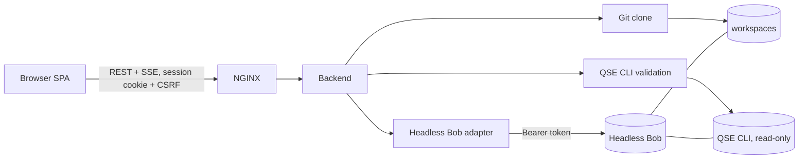

# QSE Automation Workbench

A web application that orchestrates quantum-safe analysis through **Headless Bob** (an IBM Bob Shell HTTP service that runs on the user's laptop). You connect Bob, clone a GitHub repository, point the Workbench at the **QSE CLI**, describe a task in natural language, and watch Bob run it live. Bob's own end-to-end report is retrieved, rendered and kept in an execution history.

- **Frontend:** React 18, TypeScript, Vite, IBM Carbon (G100 dark), React Router, TanStack Query, Zustand
- **Backend:** Node.js, Express 5, TypeScript, SQLite (`node:sqlite`), SSE for live updates
- **Deployment:** the demo runs in Docker / Podman containers (Compose, NGINX); real analysis runs directly on your Mac

> **What this application does not do:** it never invents findings. In `realtime` mode, reports come only from what Headless Bob actually returns; if Bob returns nothing, the report says so. In `mock` (demo) mode, the app replays a **recording of one real run** and labels the header, history, report and downloads `DEMO`.

## Stream mode: `mock` (demo) vs `realtime`

One variable, `STREAM_MODE`, decides whether the app talks to anything real. Valid values are `mock` and `realtime`; anything else stops the backend at start-up.

| | `STREAM_MODE=mock` (**default**) | `STREAM_MODE=realtime` |
|---|---|---|
| Purpose | Demo / hosted demo site | Real analysis |
| **How you run it** | **In containers:** `podman compose up -d --build` | **Everything on your Mac:** `npm start` + `npm run dev` |
| **Open** | <http://localhost:8080> | <http://localhost:5173> |
| Headless Bob | Never contacted. The address and API key you type are discarded, not stored | Headless Bob **on your laptop**, address `http://127.0.0.1:8000` |
| GitHub / `git clone` | Not run. The recorded repository (`SunilManika/crypto-inventory-demo`) is presented | Real clone into the isolated workspace |
| QSE CLI | Not executed. The recorded version is shown | Located, executed for validation, run by Bob |
| Execution | Replays the recorded steps, Bob log lines and report (about 20 s instead of 4 m 13 s) | Real run, real events |
| Prompt | Accepted but **not sent anywhere**; the report states which prompt was actually recorded | Sent to Bob |
| Report | The real report from the recording, with a `DEMO` notice at the top | Bob's report |
| Artifacts | The 4 recorded files (report plus three scan JSON files) | Files Bob produced |
| Database | `workbench-demo.sqlite` | `workbench.sqlite` |
| Needs Bob, Java, QSE CLI, internet | No | Yes |
| `.env` file | `deployment/.env` | project-root `.env` |

## Quick start: pick one flow

Use **one flow at a time**: both listen on port `8080`, so stop one before starting the other (see [Switching between the flows](#switching-between-the-flows)).

### Flow 1 – Demo: `STREAM_MODE=mock` (containers)

No Bob, Java, QSE CLI or internet is needed. Everything is replayed from a recording of one real run.

1. Create `deployment/.env` (see [Where the `.env` file goes](#where-the-env-file-goes)) with at least:

   ```dotenv
   STREAM_MODE=mock
   SECRETS_KEYS=k1:<generated>          # echo "k1:$(openssl rand -base64 32)"
   ADMIN_USERNAME=admin
   ADMIN_PASSWORD=<12+ characters>
   COOKIE_SECURE=false
   NODE_ENV=development
   ```

2. Build and start the containers:

   ```bash
   cd deployment
   mkdir -p qse-cli                    # empty folder; the demo does not use the CLI, Compose just mounts it
   podman compose up -d --build        # Docker: docker compose up -d --build
   ```

   Do **not** add `--profile bob`: the demo never contacts Bob. (Podman on macOS needs the one-time setup in [Setup B](#setup-b--demo-in-containers-with-podman).)

3. Open <http://localhost:8080> and sign in with `ADMIN_USERNAME` / `ADMIN_PASSWORD`.
4. Confirm the mode: the header shows **Bob: Demo — Connected** followed by a `STREAM_MODE=mock` tag.
5. Walk through **Bob Connection → Repository → QSE → Execution Workspace** as in [First use of the UI](#first-use-of-the-ui). Any address, key and GitHub URL on an allowed host are accepted and ignored.
6. Stop it with `podman compose down`.

### Flow 2 – Real: `STREAM_MODE=realtime` (everything on your Mac)

Headless Bob, the QSE CLI, the Workbench backend and the UI all run directly on your laptop. Complete the [Prerequisites](#prerequisites) first (Bob running, QSE CLI installed and its licence accepted, Java, Node).

1. **Stop the Workbench containers** if the demo is running (they hold port 8080):

   ```bash
   cd deployment
   podman compose down
   ```

2. In the **project-root** `.env`, set `STREAM_MODE=realtime` and the other Setup A values (full list in [Setup A](#setup-a--local-bob-and-qse-cli-on-the-same-machine)).
3. Start the backend:

   ```bash
   cd backend
   npm start
   ```

   The start-up log must say `STREAM_MODE=realtime: real Headless Bob, git and QSE CLI`.

4. In a second terminal, start the UI:

   ```bash
   cd frontend
   npm run dev
   ```

5. Open <http://localhost:5173> (not `:8080`) and use **`http://127.0.0.1:8000`** as the Headless Bob address, with your Headless Bob service token as the API key.

> **Why realtime does not run in containers.** Headless Bob receives the repository and the QSE CLI as file paths and must open exactly those files. A Bob running on your laptop cannot open a container's `/data/workspaces` or `/opt/qse-cli`, and a container cannot reach it at `127.0.0.1`. The QSE licence must also be accepted for the user that runs the CLI, which is your own account on the Mac.

### Switching between the flows

1. Stop the one that is running: `Ctrl-C` in the two terminals (real), or `podman compose down` in `deployment/` (demo).
2. Make sure `STREAM_MODE` is correct in the file that flow reads: root `.env` (real) or `deployment/.env` (demo). Keep exactly one `STREAM_MODE=` line; if a variable appears twice, the last one wins.
3. Start the other flow and reload the browser.

Demo and real data live in **separate databases**, so switching never mixes them, and the history of one mode is not visible in the other. Each database creates its own admin account the first time it starts, using the `ADMIN_PASSWORD` in force at that moment.

### Rules

- **`mock` is the default.** A fresh install shows the demo until you set `STREAM_MODE=realtime`. Set it in the project-root `.env` for the real flow.
- **`realtime` serves no demo data at all.** The recording is not even loaded, and there is no fallback to demo content when Bob, git or the CLI fails. Failures are shown as failures.
- Demo content is **recorded, not generated**. The files are in [`backend/demo-data/`](backend/demo-data); local paths were replaced with placeholders. Do not edit them to add findings. If the recording is missing or altered, the backend refuses to start in `mock` mode.
- A demo run always shows the **same** analysis (a Java repository, 48 crypto assets, 13 "Not Quantum Safe"), whatever repository URL or prompt is entered. Invalid input (a non-allowed host, a bad branch name, an empty prompt) is still rejected.
- Demo mode is safe to host on `NODE_ENV=production` because it contacts nothing and accepts no secrets. Login, CSRF, roles and rate limits still apply. For public hosting serve it over HTTPS (`docker-compose.tls.yml`, or a TLS-terminating proxy), because production forces secure cookies.

### Check which mode is running

| Where | `mock` | `realtime` |
|---|---|---|
| Backend log at start-up | `STREAM_MODE=mock: serving RECORDED DEMO DATA only…` (warning) | `STREAM_MODE=realtime: real Headless Bob, git and QSE CLI. No demo data is served.` |
| UI header | `Bob: Demo — Connected` followed by a **`STREAM_MODE=mock`** tag (hover it for the explanation) | `Bob: <state>` with no tag |
| **Settings → Stream mode** | `mock – demo, recorded data` | `realtime – live Headless Bob` |
| History / Reports | `DEMO` tag on every row | No tag |
| Downloaded files | `qse-report-<id>-DEMO.md` / `.pdf` / `.json` | `qse-report-<id>.md` … |
| `GET /api/settings` (signed in) | `"streamMode": "mock"` | `"streamMode": "realtime"` |

For containers: `podman compose logs backend | grep STREAM_MODE`.

### Demo pacing (mock only)

These variables only change how quickly the recording is replayed. They have no effect in `realtime`.

| Variable | Default | Meaning |
|---|---|---|
| `DEMO_STEP_DELAY_MS` | `700` | Pause after each backend step |
| `DEMO_BOB_WAIT_MS` | `6000` | Pause standing in for Bob's analysis time before the recorded output starts |
| `DEMO_REPLAY_SPEED` | `4` | Recorded gaps between Bob log lines are divided by this (each gap is capped at 2.5 s) |
| `DEMO_DATA_DIR` | bundled `backend/demo-data` | Where the recording is read from |

Cancelling a demo execution works like a real one. A cancelled demo run produces no report.

## Contents

1. [Stream mode: mock vs realtime](#stream-mode-mock-demo-vs-realtime)
2. [Quick start: pick one flow](#quick-start-pick-one-flow)
3. [How it works](#how-it-works)
4. [Prerequisites](#prerequisites)
5. [Choose a setup](#choose-a-setup)
6. [Where the `.env` file goes](#where-the-env-file-goes)
7. [Environment variables you must set](#environment-variables-you-must-set)
8. [Setup A – Real (`realtime`): everything on your Mac](#setup-a--local-bob-and-qse-cli-on-the-same-machine)
9. [Setup B – Demo (`mock`) in containers with Podman](#setup-b--demo-in-containers-with-podman)
10. [Setup B – Demo (`mock`) in containers with Docker](#setup-b--demo-in-containers-with-docker)
11. [First use of the UI](#first-use-of-the-ui)
12. [Local development](#local-development)
13. [Troubleshooting](#troubleshooting)
14. [Quality gates](#quality-gates) · [Honest limitations](#honest-limitations) · [Documentation](#documentation)

## How it works



The browser never talks to Headless Bob. The backend holds the Bob API key (AES-256-GCM encrypted at rest) and does every external call.

### The one rule that decides your setup

Headless Bob's message API accepts **text only**. Repository and QSE CLI context is therefore sent as **file paths inside the prompt**, and **Bob must be able to open those exact files**. The Workbench cannot upload anything to Bob.

For real analysis (`realtime`) Bob runs on your laptop next to the backend, so use `colocated`. `EXECUTION_STRATEGY` tells the backend how to translate its own paths into the paths Bob sees:

| Strategy | Use when | Path translation |
|---|---|---|
| `colocated` | Bob runs **on the same machine/filesystem view** as the backend (e.g. both directly on your Mac) | none (identity) |
| `shared-volume` (compose default) | Not used by the documented flows: Bob would have to run in a container with the same mounts as the backend. The demo (`mock`) ignores it. | `WORKSPACE_ROOT` → `BOB_WORKSPACE_MOUNT_DIR`, `QSE_MOUNT_DIR` → `BOB_QSE_MOUNT_DIR` |

A QSE CLI outside the mapped directories is shown as "not reachable from Headless Bob" and execution is blocked. See [docs/ARCHITECTURE.md](docs/ARCHITECTURE.md).

## Prerequisites

**These are needed for the real flow (`realtime`) only.** The demo flow needs just Podman or Docker (see [Setup B](#setup-b--demo-in-containers-with-podman)).

Check every item before you start. Each one has a command to verify it. **The Workbench does not install, license or start any of these for you.**

### 1. Accounts, licences and software you must already have

| # | You need | Why | Verify |
|---|---|---|---|
| 1 | **A running Headless Bob** (IBM Bob Shell HTTP service) and an active **Bob API key** | The Workbench sends every task to it. It does the analysis. | `curl http://127.0.0.1:8000/healthz` returns `{"status":"ok"}` |
| 2 | **A Headless Bob service token** – one of the values in Headless Bob's `AUTH_TOKENS` (for example the `owner` entry) | This is what you paste into the Workbench as the "API key". It is **not** Bob Shell's own `BOB_API_KEY`. | Ask whoever runs Bob, or read `AUTH_TOKENS` in Bob's `.env` |
| 3 | **IBM Quantum Safe Explorer CLI (`qse-cli`) 2.3.x** installed on the machine, with its **licence already accepted by you** | Bob runs it to scan the code. The Workbench never accepts an IBM licence for you. | `ls <qse dir>/cli.sh` and `cat ~/qs-explorer/license/status.dat` (see [accepting the licence](#5-accepting-the-qse-licence)) |
| 4 | **Java 17 or newer** on the same machine | The QSE CLI is a Java program | `java -version` |
| 5 | **Node.js 22.13 or newer** and npm | Runs the backend (uses the built-in `node:sqlite`) and builds the UI | `node -v` |
| 6 | **Git** | The backend clones repositories with it | `git --version` |
| 7 | **Network access to `github.com`** | Cloning. For private repositories, also a GitHub personal access token with read access to the repository | `git ls-remote https://github.com/<owner>/<repo>` |
| 8 | **OpenSSL** (preinstalled on macOS and most Linux) | Generates the encryption key | `openssl version` |

Only for the demo in containers (Setup B): **Podman** (tested with 6.0 on macOS) or **Docker** with Compose v2, and about 1 GB of free disk space for the images.

### 2. Operating system

macOS or Linux. Setup A has been run on macOS (Apple silicon). Windows is not tested; use WSL 2 and treat it as Linux.

### 3. Ports that must be free

| Port | Used by | Setup |
|---|---|---|
| `8080` | Workbench backend (API) | A |
| `5173` | Workbench UI (Vite) | A |
| `8000` | Headless Bob on your laptop (not started by the Workbench) | A |
| `8080` | NGINX frontend (demo in containers) | B |

Check with `lsof -nP -iTCP:8080 -sTCP:LISTEN`. **Run only one Workbench at a time.** If a containerised Workbench and a local one both listen on `8080`, your browser may reach the wrong one (see [Troubleshooting](#troubleshooting)).

### 4. Headless Bob must be able to see the files

Headless Bob receives the repository and the QSE CLI as **paths in the prompt text**. Bob must be able to open **exactly those paths**.

- Real analysis: Headless Bob runs **on your laptop**, on the same machine as the Workbench backend → use **Setup A** (`EXECUTION_STRATEGY=colocated`).
- The container setup (Setup B) is the **demo** only and never contacts Bob.

If this is not true, runs finish but Bob reports that the paths do not exist and produces no findings. See [How it works](#the-one-rule-that-decides-your-setup).

### 5. Accepting the QSE licence

The QSE CLI refuses to analyse anything until its licence has been accepted by the **user that runs it**. Do this once, yourself, by following IBM's instructions for the CLI (running it interactively as that user). The state is stored in `$HOME/qs-explorer/license/status.dat`. A fresh container has no such state, which is why real analysis runs on your Mac, where your account has already accepted it.

### 6. Information to have ready

- Headless Bob address (for Setup A usually `http://127.0.0.1:8000`) and its service token
- GitHub repository URL and branch (and a token for private repositories)
- Absolute path to the QSE CLI directory (for example `/usr/local/bin/qse-cli-artifacts`)
- An admin password for the Workbench (12 or more characters) – you choose it

## Choose a setup

| | Setup A – Real (`realtime`) | Setup B – Demo (`mock`) |
|---|---|---|
| Where it runs | Directly on your Mac | Containers (Podman or Docker) |
| Backend | `npm start` in `backend/` | container |
| Frontend | `npm run dev` in `frontend/` (port 5173) | NGINX container (port 8080) |
| Headless Bob | **on your laptop**, `http://127.0.0.1:8000` | not used |
| QSE CLI, Java | on your Mac | not used |
| `EXECUTION_STRATEGY` | `colocated` | ignored |
| `.env` location | **project root** `.env` | **`deployment/.env`** |
| `STREAM_MODE` | `realtime` | `mock` |

Do not combine them: a containerised Workbench cannot reach a laptop Bob at `127.0.0.1`, and Bob cannot open paths inside the container. If you see `Connection refused` or `Invalid Host header`, see [Troubleshooting](#troubleshooting).

## Where the `.env` file goes

Different tools read different files. **Creating the wrong one is the most common setup problem.**

| File | Read by | Used for |
|---|---|---|
| `<project>/.env` | `npm start`, `npm run dev` in `backend/` (loaded via `--env-file-if-exists=../.env`) | **Setup A** (real) |
| `<project>/backend/.env` | the same scripts, loaded **after** the root file, so it **overrides** duplicate keys | optional per-developer overrides |
| `<project>/deployment/.env` | `docker compose` / `podman compose` run **from `deployment/`** | **Setup B** (demo) |
| `<project>/.env.example` | nobody – it is the template | copy it |

Rules to remember:

- The backend never opens `.env` by itself; it only reads process environment variables. The npm scripts and Compose inject them.
- `docker compose` only reads `.env` from the directory it runs in (or from `--env-file`). **The root `.env` is ignored by Compose.**
- The backend container is configured by `docker-compose.yml`, which forwards selected variables. Editing `backend/.env` has **no effect** on containers.
- Variables are `KEY=value`, one per line, **no spaces around `=`**, and no quotes needed. JSON values (e.g. `AUTH_TOKENS`) are written on one line.
- A later duplicate key wins. Do not leave two `EXECUTION_STRATEGY=` lines.
- Never commit a real `.env` (it is in `.gitignore`). Restrict it: `chmod 600 .env`.
- Restart after every change: stop and re-run `npm start`, or `compose up -d` again.

### Create it

```bash
# Setup A (real)
cd qse-automation-workbench
cp .env.example .env
chmod 600 .env

# Setup B (demo)
cd qse-automation-workbench/deployment
cp ../.env.example .env
chmod 600 .env
```

## Environment variables you must set

Generate the secrets:

```bash
echo "k1:$(openssl rand -base64 32)"                 # → SECRETS_KEYS
openssl rand -base64 24 | tr -d '/+=' | cut -c1-32     # → Bob service token / ADMIN_PASSWORD
```

| Variable | Setup | Value |
|---|---|---|
| `STREAM_MODE` | A, B | **A: `realtime`. B: `mock`.** The default is `mock`, which shows a recorded demo and never contacts Bob, GitHub or the QSE CLI (see [Stream mode](#stream-mode-mock-demo-vs-realtime)). |
| `SECRETS_KEYS` | A, B | `k1:<base64 of 32 bytes>`. **Required.** Keep it: losing it makes the stored Bob key unreadable. |
| `ADMIN_USERNAME` / `ADMIN_PASSWORD` | A, B | UI login. Password ≥ 12 characters. **Required.** |
| `NODE_ENV` | A | `development` for plain HTTP locally. `production` forces secure cookies and needs HTTPS. |
| `COOKIE_SECURE` | B | `false` when you browse over plain `http://localhost:8080`. |
| `EXECUTION_STRATEGY` | A | `colocated` |
| `WORKSPACE_ROOT` | A | Absolute directory where repositories are cloned, e.g. `/Users/you/qse-workspaces`. **Bob must be able to read it.** |
| `QSE_CLI_ALLOWED_DIRS` / `QSE_CLI_SEARCH_DIRS` | A | Directory that contains the CLI, e.g. `/usr/local/bin/qse-cli-artifacts` (no trailing slash). |
| `QSE_CLI_VERSION_ARGS` | A | Defaults to **`-v`**: the IBM QSE CLI 2.3.x does **not** support `--version` (it prints usage). |
| `HTTP_PORT` | B | Host port of the NGINX frontend. Default `8080`. |

Minimal **Setup A** (real) `.env`:

```dotenv
SECRETS_KEYS=k1:<generated>
ADMIN_USERNAME=admin
ADMIN_PASSWORD=<12+ characters>
NODE_ENV=development
EXECUTION_STRATEGY=colocated
WORKSPACE_ROOT=/Users/you/qse-workspaces
QSE_CLI_ALLOWED_DIRS=/usr/local/bin/qse-cli-artifacts
QSE_CLI_SEARCH_DIRS=/usr/local/bin/qse-cli-artifacts
QSE_CLI_VERSION_ARGS=-v
STREAM_MODE=realtime
```

Minimal **Setup B** (demo) `deployment/.env`:

```dotenv
STREAM_MODE=mock
SECRETS_KEYS=k1:<generated>
ADMIN_USERNAME=admin
ADMIN_PASSWORD=<12+ characters>
NODE_ENV=development
COOKIE_SECURE=false
HTTP_PORT=8080
```

The full list with comments is in [.env.example](.env.example) and [docs/DEPLOYMENT.md](docs/DEPLOYMENT.md).

> **Real flow only:** the value to paste as the **Bob API key in the UI** is one of the service tokens from Headless Bob's `AUTH_TOKENS`, not Bob Shell's own `BOB_API_KEY`. In the demo any value is accepted and ignored.

## Setup A – Local (Bob and QSE CLI on the same machine)

This is the **real-analysis** setup (`STREAM_MODE=realtime`): Headless Bob, the QSE CLI, the backend and the UI all run on your Mac. Complete the [Prerequisites](#prerequisites) first. The short version is [Flow 2](#flow-2--real-stream_moderealtime-everything-on-your-mac).

### Step 0 – Stop the demo containers (if running)

They hold port 8080:

```bash
cd deployment
podman compose down
```

### Step 1 – Get the code and install dependencies

```bash
cd qse-automation-workbench
(cd backend  && npm ci && npm run build)
(cd frontend && npm ci)
```

### Step 2 – Create the workspace directory

Repositories are cloned here. Headless Bob must be able to read it, so use a path under your own home directory:

```bash
mkdir -p ~/qse-workspaces
```

### Step 3 – Create and edit `.env` (project root)

```bash
cp .env.example .env
chmod 600 .env
echo "SECRETS_KEYS=k1:$(openssl rand -base64 32)"      # copy this line into .env
```

Set at least the following in `.env` (replace `you`). Remove or ignore the other lines in the file; unused ones are harmless.

```dotenv
SECRETS_KEYS=k1:<the generated value>
ADMIN_USERNAME=admin
ADMIN_PASSWORD=<your password, 12+ characters>
NODE_ENV=development
COOKIE_SECURE=false
EXECUTION_STRATEGY=colocated
WORKSPACE_ROOT=/Users/you/qse-workspaces
QSE_CLI_ALLOWED_DIRS=/usr/local/bin/qse-cli-artifacts
QSE_CLI_SEARCH_DIRS=/usr/local/bin/qse-cli-artifacts
QSE_CLI_VERSION_ARGS=-v
STREAM_MODE=realtime
```

Replace `/usr/local/bin/qse-cli-artifacts` with the directory that contains your `cli.sh`, without a trailing slash. If the file contains a line twice, the last one wins. Do not leave two `EXECUTION_STRATEGY=` lines.

### Step 4 – Start the backend

```bash
cd backend
npm start                      # leave running; listens on http://127.0.0.1:8080
```

Check it from another terminal: `curl http://127.0.0.1:8080/readyz` returns `{"status":"ready",...}`.
The start-up log must say `STREAM_MODE=realtime: real Headless Bob, git and QSE CLI`. If it says `serving RECORDED DEMO DATA only`, `STREAM_MODE` is missing or set to `mock` in `.env`.
A log line `.env not found. Continuing without it.` is harmless; it refers to the optional `backend/.env`.

### Step 5 – Start the UI

```bash
cd frontend
npm run dev                    # leave running; serves http://localhost:5173
```

### Step 6 – Sign in and run

Open **<http://localhost:5173>** (not `:8080`). Sign in with `ADMIN_USERNAME` / `ADMIN_PASSWORD` and follow [First use of the UI](#first-use-of-the-ui).
Use `http://127.0.0.1:8000` as the Headless Bob address.

> **The admin account is created only the first time the backend starts with an empty database** (`backend/data/db/`). Changing `ADMIN_PASSWORD` later does not change an existing account. To start over, stop the backend and delete `backend/data/`; this also deletes the saved Bob connection, repository records and execution history.

### Stopping

Press `Ctrl-C` in both terminals. Data stays in `backend/data/`.

## Setup B – Demo in containers with Podman

This runs `STREAM_MODE=mock` only. Headless Bob, Java and the QSE CLI are **not** involved, so there is no Bob image to build and no `--profile bob`.

Tested toolchain: Podman 6 on macOS (applehv machine).

### Step 1 – Start the Podman machine

```bash
podman machine list
podman machine start            # skip if already "Currently running"
podman info --format '{{.Host.RemoteSocket.Path}}'
```

### Step 2 – Make `podman compose` work

`podman compose` is only a wrapper: it runs whichever `docker-compose` / `podman-compose` it finds. If it picks up Rancher Desktop's `docker-compose` (`~/.rd/bin/docker-compose`) that binary must be pointed at the Podman socket, otherwise it reports that no Docker daemon is running.

```bash
export DOCKER_HOST="unix://$(podman machine inspect --format '{{.ConnectionInfo.PodmanSocket.Path}}')"
podman compose version          # should print a Compose version without errors
```

Keep this `export` in the same terminal for all the next steps (add it to `~/.zshrc` to make it permanent).

### Step 3 – Create `deployment/.env`

```bash
cd qse-automation-workbench/deployment
cp ../.env.example .env
chmod 600 .env
echo "SECRETS_KEYS=k1:$(openssl rand -base64 32)"      # copy this line into .env
```

Set the **Setup B (demo)** values from [above](#environment-variables-you-must-set), in particular `STREAM_MODE=mock`, `SECRETS_KEYS`, `ADMIN_PASSWORD` and `COOKIE_SECURE=false`. Check that nothing required is empty (prints key names only):

```bash
pwd                                                  # must end in /deployment
grep -E '^(STREAM_MODE|SECRETS_KEYS|ADMIN_PASSWORD)=.+' .env | cut -d= -f1
```

### Step 4 – Build and start

```bash
cd qse-automation-workbench/deployment
mkdir -p qse-cli                                # empty; Compose mounts it but the demo never reads it
podman compose up -d --build
```

### Step 5 – Check health

```bash
podman compose ps                                # frontend and backend should become "healthy"
podman compose logs backend | grep STREAM_MODE  # must say: serving RECORDED DEMO DATA only
curl -fsS http://localhost:8080/nginx-health
```

### Step 6 – Use it

Open <http://localhost:8080>, sign in with `ADMIN_USERNAME` / `ADMIN_PASSWORD`. The header shows **Bob: Demo — Connected** and a `STREAM_MODE=mock` tag. Follow [First use of the UI](#first-use-of-the-ui).

### Stop, restart, clean up

```bash
podman compose down                              # stop; named volumes (demo history) are kept
podman compose down -v                           # also deletes the demo history
podman compose up -d --build                     # re-run after changing .env or code
```

Run `podman compose down` before starting the real flow, so port 8080 is free.

## Setup B – Demo in containers with Docker

Identical to the Podman steps, minus Steps 1–2:

```bash
cd qse-automation-workbench/deployment
cp ../.env.example .env && chmod 600 .env       # set STREAM_MODE=mock and the other values as above
mkdir -p qse-cli
docker compose up -d --build
```

HTTPS: `docker compose -f docker-compose.yml -f docker-compose.tls.yml up -d --build` with `deployment/certs/tls.crt` and `tls.key`.

## First use of the UI

In `STREAM_MODE=mock` every step below succeeds against the recording and is labelled DEMO; in `realtime` each step does the real work.

1. **Bob Connection** – real flow: `http://127.0.0.1:8000` and your service token → *Save* → *Test connection*. Demo: any values; it shows *Connected* from the recording.
2. **Repository Configuration** – GitHub URL, branch, optional token → *Clone*. Re-clone after changing `EXECUTION_STRATEGY` or `WORKSPACE_ROOT`.
3. **QSE Configuration** – *Run discovery* (or enter the absolute path) → *Validate*. Must show a version such as `App Version : 2.3.1.0` and "reachable from Headless Bob".
4. **Execution Workspace** – write a prompt → *Start execution*.
5. **Reports** / **Execution History** – read and download results.

## Local development

```bash
cd backend && npm ci
export SECRETS_KEYS="k1:$(openssl rand -base64 32)" ADMIN_PASSWORD='a-long-dev-password'
export STREAM_MODE=mock                    # default: demo replay. Use realtime for real Bob/git/QSE (Flow 2)
npm run dev                                # http://localhost:8080, also loads ../.env and ./.env

cd frontend && npm ci && npm run dev       # http://localhost:5173, proxies /api to :8080
```

## Troubleshooting

| Symptom | Cause and fix |
|---|---|
| `SECRETS_KEYS` / `ADMIN_PASSWORD` "must be set" | The `.env` is in the wrong place (see [table](#where-the-env-file-goes)) or the line has spaces around `=`. |
| Compose says a variable is unset | You ran it outside `deployment/`, or edited the root `.env`. Compose reads `deployment/.env`. |
| Changes to `.env` ignored | Restart the process; for containers run `compose up -d` again (`restart` does not re-read the file). |
| QSE page: "Not reachable from Headless Bob" | The CLI directory is not covered by the strategy. Set `QSE_CLI_ALLOWED_DIRS`/`QSE_CLI_SEARCH_DIRS` and `EXECUTION_STRATEGY=colocated` in the root `.env` (real flow). |
| QSE validation shows usage text or a licence text | `--version` is unsupported; the default is now `-v` (set `QSE_CLI_VERSION_ARGS=-v` if you override it). If it shows "License Agreement have not been accepted", accept the licence yourself by running the CLI interactively as the user that runs the backend. |
| `statfs ... no such file or directory` (Podman) | A mounted path is outside `$HOME` or not shared with the Podman VM. For the demo, run `mkdir -p deployment/qse-cli` and leave `QSE_CLI_HOST_DIR` unset. |
| `the classic builder doesn't support additional contexts` | Fixed in the current tree: the frontend image is built with the project root as context (`.dockerignore` at the root limits what is sent). Pull the latest files; do not set `additional_contexts` back. |
| `HEALTHCHECK is not supported for OCI image format` (Podman build warning) | Harmless for the build. Compose healthchecks in `docker-compose.yml` still apply. |
| `Cannot connect to the Docker daemon` from `podman compose` | `DOCKER_HOST` is not pointed at the Podman socket (Step 2). |
| Bob cannot find the repository | Bob's filesystem does not contain `WORKSPACE_ROOT`. Bob must run on the same machine as the backend (Setup A). |
| Bob run stops after 5 minutes | Raise `BOB_RUN_TIMEOUT_MS` on the Bob side. |
| `.env not found` log line | Harmless: the optional `backend/.env` does not exist. |
| "Connection refused" on Bob Connection although Bob is running | You are talking to a **containerised** Workbench, where `127.0.0.1` is the container itself, not your Mac. Real analysis runs on the Mac: `podman compose down`, make sure only one process listens on `8080` (`lsof -nP -iTCP:8080 -sTCP:LISTEN`), run `npm start` and `npm run dev`, open `http://localhost:5173`, and use `http://127.0.0.1:8000`. |
| `Authentication failed (HTTP 403): Invalid Host header` | A Headless Bob on your laptop without `AUTH_TOKENS` only accepts requests addressed to `localhost` / `127.0.0.1`. You reached it through another name (for example `host.containers.internal` from a container). Run the Workbench on the Mac and use `http://127.0.0.1:8000`. |
| The header shows a **`STREAM_MODE=mock`** tag, or Bob "connects" with any address | `STREAM_MODE` is `mock` (the default). For real analysis set `STREAM_MODE=realtime` in the **project-root** `.env` and restart `npm start`. Demo and real data use different databases, so history is not shared. |
| Sign-in fails with the password in `.env` | The admin account already exists in `backend/data/db/` from an earlier start. Use the original password, or stop the backend and delete `backend/data/` to recreate it. |
| Run "Completed" but the report says paths do not exist | Bob cannot see `WORKSPACE_ROOT` or the QSE CLI directory. Run the Workbench on the Mac next to Bob (Setup A), then **re-clone** the repository and **Validate** QSE again. |
| `EADDRINUSE` on port 8080 | Another process (often an old backend or a container) holds the port. `lsof -nP -iTCP:8080 -sTCP:LISTEN`, stop it, start again. |
| Node error about `node:sqlite` | Node.js is older than 22.13. Upgrade Node. |

## Quality gates

```bash
cd backend  && npm run typecheck && npm test && npm run build && npm audit --omit=dev
cd frontend && npm run typecheck && npm test && npm run build && npm audit --omit=dev
```

Backend tests run the real Express app against an in-process **FakeBob** that implements the documented Headless Bob REST contract (workflow, cancel, failure, fallback report, auth/CSRF/roles/rate-limit, SSRF, GitHub, QSE, report generation). Frontend tests use Testing Library with a mocked `fetch`. `backend/tests/integration/demo.test.ts` covers `STREAM_MODE=mock` (full replay with git and the CLI unavailable, no request reaching Bob, cancellation) and proves `realtime` serves no demo data.

## Honest limitations

- **Live chain.** `realtime` has been run end to end against a real Headless Bob and the real QSE CLI (one recorded run is what the demo replays). Other Bob versions or CLIs may differ; the adapter follows the Headless Bob source and OpenAPI spec.
- **Demo mode answers one fixed question.** `STREAM_MODE=mock` always shows the single recorded analysis (Java repository, 48 crypto assets), whatever repository URL or prompt is entered.
- **Real analysis runs on your laptop.** Containers are the demo only. Headless Bob has no structured fields for repository or CLI context, so Bob must open the same filesystem paths as the backend.
- **No QSE-level progress.** Bob does not expose QSE phase or percentage progress, so none is shown. The UI displays real run events and streamed output only.
- **QSE version flag.** The default `QSE_CLI_VERSION_ARGS` is `-v` (IBM QSE CLI 2.3.x does not support `--version`). The validator records the line that looks like `App Version : ...`, falling back to the first output line for other CLIs.
- **Licence state.** If the CLI reports that its licence has not been accepted for the backend's user, validation is reported as `invalid` with instructions. The Workbench never accepts the licence for you.
- **Run timeout.** Headless Bob's default is 5 minutes (`RUN_TIMEOUT_MS`); raise it for large scans.
- **ACP protocol has no file API**, so with the ACP adapter only Bob's final answer (not workspace files) can be retrieved.

## Documentation

- [Architecture](docs/ARCHITECTURE.md)
- [API reference](docs/API.md)
- [Deployment guide](docs/DEPLOYMENT.md)
- [Security model](docs/SECURITY.md)
