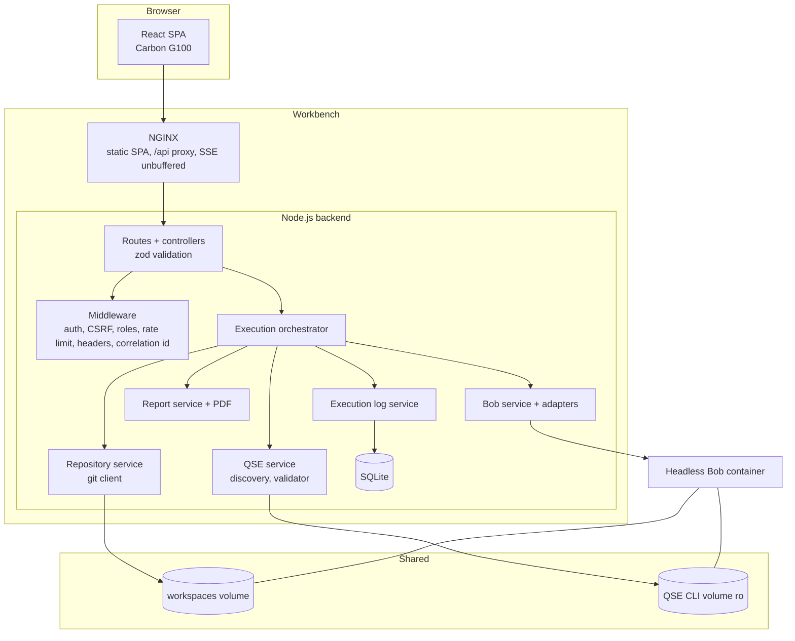
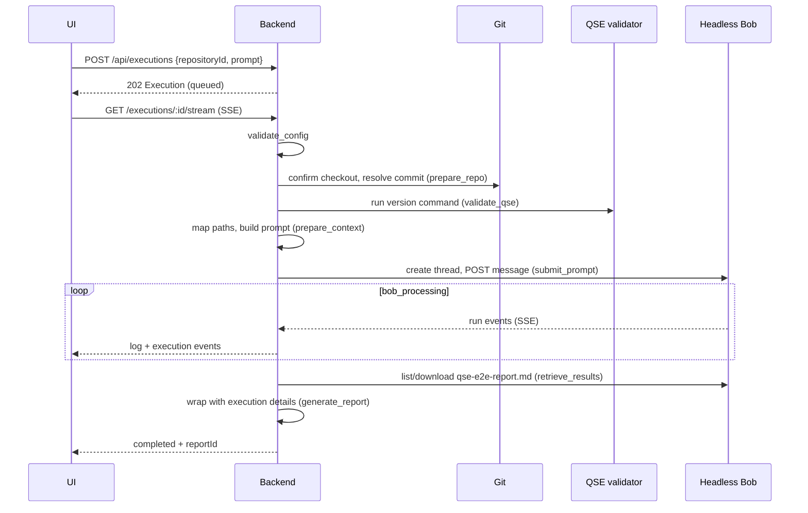

# Architecture

## Components

## Backend layout (`backend/src`)

| Directory | Responsibility |
|---|---|
| `config/` | Environment parsing and validation (zod); refuses to start on invalid config. |
| `controllers/`, `routes/` | HTTP layer, request validation, role checks. |
| `middleware/` | Request context (correlation ID, structured logging), authentication, CSRF/origin checks, rate limits, security headers, CORS, central error handler. |
| `services/` | Business logic: Bob, repositories, QSE, reports, PDF, execution logs. |
| `integrations/headless-bob/` | Adapter layer. `rest-threads` (primary) and `acp`; `factory` selects one and refuses to build any when `STREAM_MODE=mock`. `http-client` adds SSRF protection, timeouts, auth and SSE parsing. |
| `integrations/github/` | URL validator and a `git` runner (argument arrays, no shell, token never on the command line). |
| `integrations/qse-cli/` | Discovery (env var, `PATH`, configured dirs) and validation. |
| `orchestrators/` | `ExecutionOrchestrator`, step definitions, prompt builder. |
| `repositories/` | SQLite persistence (users, sessions, Bob connection, git repos, QSE config, executions, logs, reports, artifacts). |
| `utils/` | `SecretBox` (AES-256-GCM), password hashing, redaction, safe process execution, path safety and `PathMapper`, SSRF helpers, logger. |

Adding another CLI or another agent runtime means adding an integration directory and an adapter implementing the same interface; the orchestrator depends on the interfaces, not on QSE or Bob specifics.

## Headless Bob contract used

Taken from the Headless Bob source and `spec/openapi.yaml`. Authentication is `Authorization: Bearer <service token>` (tokens come from Bob's `AUTH_TOKENS`); the auth mode, header name and API base path are configurable per connection.

| Purpose | Request |
|---|---|
| Liveness | `GET /healthz` (no auth) |
| Capabilities | `GET {base}/capabilities` |
| Create thread | `POST {base}/threads` `{title}` |
| Submit prompt | `POST {base}/threads/{id}/messages` `{content}` (max 20 000 chars) → `202 {thread, run, events_url}` |
| Live events | `GET {base}/runs/{runId}/events` (SSE, `?after=` for resume) |
| Run state | `GET {base}/runs/{runId}` |
| Cancel | `POST {base}/runs/{runId}/cancel` |
| List / download files | `GET {base}/threads/{id}/files`, `.../files/download?path=` |

Run statuses: `created | in-progress | cancelling | cancelled | completed | failed`.

**Gaps (documented, not papered over):**

- The message API takes plain text only. Repository and CLI context therefore travel inside the prompt as paths plus explicit rules.
- Bob creates its own workspace and does not accept uploads, so the repo and CLI must be on shared volumes.
- Bob reports no QSE-specific phases or percentages. The UI shows only real run events and streamed output.
- ACP (`protocol: acp`) exposes runs and events but no file API.
- Default run timeout is 5 minutes (`RUN_TIMEOUT_MS`).

## Execution lifecycle

Steps are tagged by source: `backend` (preparation) or `headless-bob`. There is deliberately **no** separate "QSE analysis" step, because Bob's API does not expose one.

## Reports

Priority of sources: (1) `qse-e2e-report.md` retrieved from Bob's workspace; (2) Bob's final answer; (3) "unavailable" with a warning. The backend adds only factual material it owns (execution ID, timestamps, repository, commit, QSE version, run IDs, the user prompt, retrieved artifacts). It never synthesises findings, risk scores or recommendations. The Markdown is split on `##` headings into Summary / Findings / Recommendations / Conclusion tabs by heading keywords; unmatched sections stay visible under Findings.

## Persistence

SQLite at `DATABASE_PATH` (default `/data/db/workbench.sqlite`, on the `workbench-data` volume): users, hashed sessions, encrypted Bob connection and repository tokens, QSE config, executions (steps, warnings), ordered logs, reports and artifact metadata. A Postgres adapter would replace the `repositories/` layer only.

## Real-time updates

Server-Sent Events (`GET /api/executions/:id/stream`) replay persisted log lines after a `?after=` cursor and then follow live. NGINX disables buffering for that route. The client reconnects with the last seen log ID, so a dropped connection loses nothing.

## Concurrency and shutdown

`MAX_CONCURRENT_EXECUTIONS` caps parallel runs. On `SIGTERM` the server stops accepting work (`/readyz` returns 503), closes connections and the database, and exits (hard stop after 25 s). Executions that were in flight cannot be followed after a restart, so **on the next startup** they are marked `failed` with "Interrupted by a Workbench restart" (noting that the Headless Bob run may still have finished). Clones interrupted by a restart are likewise marked failed and must be re-cloned. History therefore never shows a phantom "running" execution.
