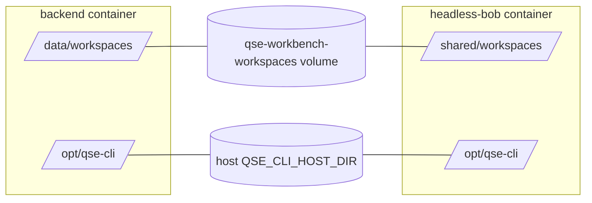

# Deployment guide

## Topology

| Service | Image | Port | Notes |
|---|---|---|---|
| `frontend` | NGINX (unprivileged) serving the Vite build | `HTTP_PORT` → 8080 (TLS override: `HTTPS_PORT` → 8443) | Proxies `/api`; SSE unbuffered. |
| `backend` | Node 24 + git + tini | 8080 (**internal only**) | API, orchestration, SQLite. |
| `headless-bob` | `HEADLESS_BOB_IMAGE` | 8000 (internal) | **Optional** (`--profile bob`). The Workbench does not own Bob's lifecycle; point it at an existing instance instead. |
| database | SQLite file on the `workbench-data` volume | – | Persistent history. |

## Execution strategy: shared volumes

Headless Bob executes work inside its own container, so a host or backend path is meaningless to it. The Workbench therefore shares **two volumes** with Bob and translates paths between the two mount points:



The Workbench reads `BOB_WORKSPACE_MOUNT_DIR` (default `/shared/workspaces`) and `BOB_QSE_MOUNT_DIR` (default `/opt/qse-cli`) to know where Bob sees each volume. A QSE CLI outside the shared mount is shown as *not reachable from Headless Bob* and executions are blocked.

The alternative `EXECUTION_STRATEGY=colocated` (identity path mapping) is only correct if Bob runs on the same filesystem view as the backend (for example both on one host without containers).

### Why not backend-mediated execution or a separate execution container?

Headless Bob's API accepts only text messages and has no "run this command" or file-upload endpoint, so the Workbench cannot push the repository or CLI into it, and the QSE CLI is run **by Bob** (in agent mode), not by the backend. The backend only runs the CLI's version command, to validate it. Shared volumes are the only mechanism the documented API supports.

## Prerequisites

- Docker Engine with Compose v2.
- A directory containing the QSE CLI (`cli.sh`/`qse-cli` and its support files), readable by uid **1001** and executable.
- A reachable Headless Bob with a service token (`AUTH_TOKENS`) — or build the bundled one (below).

## Configure

```bash
cd deployment
cp ../.env.example .env
```

Required: `SECRETS_KEYS`, `ADMIN_PASSWORD`. Set `QSE_CLI_HOST_DIR` to the CLI directory. See the table below for everything else.

```bash
echo "k1:$(openssl rand -base64 32)"      # SECRETS_KEYS
```

## Start

```bash
docker compose up -d --build                                   # Workbench only
docker compose --profile bob up -d --build                     # + bundled Headless Bob
docker compose -f docker-compose.yml -f docker-compose.tls.yml up -d --build   # HTTPS
docker compose ps                                              # all services should become "healthy"
```

Open `http://localhost:${HTTP_PORT}` (or `https://…:${HTTPS_PORT}`).

### Bundled Headless Bob (optional)

Build the image from the Headless Bob project (it needs its vendored Bob Shell tarball):

```bash
docker build -t headlessbob:latest <path-to>/headless-bob/assets/headlessbob
```

Then set in `.env`: `BOB_API_KEY` (Bob Shell key, stays in the Bob container), `AUTH_TOKENS={"workbench":"<24+ char random token>"}`, and `BOB_RUN_TIMEOUT_MS` (Bob's default is 5 minutes, too short for most QSE scans). In the UI, use address `http://headless-bob:8000` and the **`workbench` token** as the API key.

### Using an existing Headless Bob

Give your Bob container the same two mounts:

```yaml
  volumes:
    - qse-workbench-workspaces:/shared/workspaces:ro     # external: true named volume
    - /path/on/host/qse-cli:/opt/qse-cli:ro
```

and make it reachable from the backend's network (`docker network connect qse-workbench-net <container>` or attach both to a shared network). If your mount points differ, set `BOB_WORKSPACE_MOUNT_DIR` / `BOB_QSE_MOUNT_DIR` on the backend. Add its hostname to `BOB_ALLOWED_HOSTS`.

If the QSE CLI must write next to the sources, mount the workspaces volume read-write in Bob (`BOB_WORKSPACE_MOUNT_MODE=rw`) and accept the wider blast radius described in [SECURITY.md](SECURITY.md).

## First use

1. Sign in with `ADMIN_USERNAME` / `ADMIN_PASSWORD`; change the password under **Settings**.
2. **Bob Connection** → address, token → *Save* → *Test connection* (expect *Connected* and a capabilities list).
3. **Repository Configuration** → URL, branch, optional token → *Clone*.
4. **QSE Configuration** → *Run discovery* → select → *Use selected and validate*. The *Path in Bob container* must be shown, otherwise the CLI is not on the shared mount.
5. **Execution Workspace** → prompt → *Start execution*.

## Environment variables

| Variable | Default | Purpose |
|---|---|---|
| `SECRETS_KEYS` | **required** | AES-256-GCM key ring `kid:base64(32 bytes)[,…]`; first key encrypts. |
| `ADMIN_USERNAME` / `ADMIN_PASSWORD` | `admin` / **required (≥12)** | Bootstrap administrator. |
| `NODE_ENV` | `production` (Compose) | `production` forces secure cookies. |
| `PORT`, `HOST`, `LOG_LEVEL` | `8080`, `0.0.0.0`, `info` | Backend listener and logging. |
| `DATA_DIR`, `WORKSPACE_ROOT`, `DATABASE_PATH` | `/data`, `/data/workspaces`, `/data/db/workbench[-demo].sqlite` (demo and real data use separate files) | Storage locations (container paths). |
| `TLS_KEY_FILE`, `TLS_CERT_FILE` | – | Terminate TLS in the backend itself (usually NGINX does this). |
| `COOKIE_SECURE` | `false` | Force `Secure` cookies (always on in production). |
| `TRUST_PROXY` | `1` | Number of proxies in front of the backend. |
| `CORS_ALLOWED_ORIGINS` | empty | Cross-origin browser origins (none for same-origin NGINX). |
| `SESSION_TTL_MINUTES` / `SESSION_IDLE_MINUTES` | `480` / `60` | Absolute and idle session lifetime. |
| `BOB_ALLOWED_HOSTS` | empty | Allow-list of Bob host names. |
| `BOB_ALLOW_PRIVATE_NETWORK` | `true` (Compose) | Permit private/loopback Bob addresses. |
| `BOB_REQUEST_TIMEOUT_MS` | `15000` | Timeout for Bob control calls (not the run itself). |
| `STREAM_MODE` | `mock` | `mock` = demo replay of a recorded real run (nothing external is contacted). `realtime` = real Headless Bob, git and QSE CLI. Default is `mock`; set `realtime` for real use. |
| `DEMO_DATA_DIR` | bundled `demo-data` | Location of the recording (mock only). |
| `DEMO_STEP_DELAY_MS`, `DEMO_BOB_WAIT_MS`, `DEMO_REPLAY_SPEED` | `700`, `6000`, `4` | Demo pacing only. |
| `GITHUB_ALLOWED_HOSTS` | `github.com` | Allowed Git hosts (add GitHub Enterprise hosts here). |
| `GIT_BIN`, `CLONE_TIMEOUT_MS` | `git`, `600000` | Git executable and clone timeout. |
| `QSE_CLI_PATH` | empty | Explicit CLI path for discovery. |
| `QSE_CLI_SEARCH_DIRS` | `/opt/qse-cli` (Compose) | Directories scanned by discovery (plus `PATH`). |
| `QSE_CLI_ALLOWED_DIRS` | `/opt/qse-cli` (Compose) | Directories a manual path may live in. |
| `QSE_CLI_EXECUTABLE_NAMES` | `qse-cli,cli.sh` | Allowed executable file names. |
| `QSE_CLI_VERSION_ARGS` | `-v` | Version command arguments. IBM QSE CLI 2.3.x prints `App Version : ...` for `-v`; `--version` only prints usage. The line matching `Version : ...` is recorded; a "licence not accepted" output is reported as `invalid`. |
| `QSE_VALIDATION_TIMEOUT_MS` | `30000` | Version command timeout. |
| `QSE_USAGE_HINT` | built-in | Usage text embedded in the prompt for Bob. |
| `EXECUTION_STRATEGY` | `shared-volume` | `shared-volume` or `colocated`. |
| `QSE_MOUNT_DIR` / `BOB_QSE_MOUNT_DIR` | `/opt/qse-cli` | CLI mount in backend / in Bob. |
| `BOB_WORKSPACE_MOUNT_DIR` | `/shared/workspaces` | Workspace mount as seen by Bob. |
| `EXECUTION_TIMEOUT_MS` | `1800000` | Overall execution deadline in the Workbench. Bob enforces its own `RUN_TIMEOUT_MS`; whichever is shorter ends the run, so raise both for long scans. |
| `MAX_CONCURRENT_EXECUTIONS` | `1` | Parallel executions. |
| `MAX_PROMPT_CHARS` | `8000` (max 15000) | Leaves room under Bob's 20 000 character message limit for added context. |
| `MAX_ARTIFACT_BYTES`, `MAX_ARTIFACTS` | 25 MiB, 200 | Artifact retrieval limits. |
| `RATE_LIMIT_WINDOW_MS`, `RATE_LIMIT_MAX`, `LOGIN_RATE_LIMIT_MAX` | 60000, 300, 10 | Rate limiting. |
| Compose only: `HTTP_PORT`, `HTTPS_PORT`, `PUBLIC_HOST`, `QSE_CLI_HOST_DIR`, `BACKEND_JAVA_PACKAGE`, `HEADLESS_BOB_IMAGE`, `BOB_API_KEY`, `AUTH_TOKENS`, `BOB_RUN_TIMEOUT_MS`, `BOB_*_MOUNT_MODE` | see `.env.example` | Deployment wiring. |

## Operations

- **Health:** `GET /healthz`, `GET /readyz` (also proxied by NGINX); both images define `HEALTHCHECK`.
- **Logs:** `docker compose logs -f backend` (JSON, one line per event, `requestId` for correlation).
- **Backup:** `docker run --rm -v qse-workbench-data:/d -v "$PWD":/b alpine tar czf /b/workbench-data.tgz -C /d .` and keep `SECRETS_KEYS` safe — without the key ring, stored Bob keys/tokens cannot be decrypted.
- **Upgrade:** `docker compose pull && docker compose up -d --build`; schema migrations run on start.
- **Key rotation:** prepend a new `kid:key` to `SECRETS_KEYS`, restart, then Settings → *Re-encrypt stored secrets*; remove the old key later.
- **Shutdown:** `SIGTERM` drains within 25 s; in-flight executions are marked failed on the next start.
- **Cleanup:** *Clear workspace* in the UI removes a clone; `docker compose down -v` removes all data.

## Troubleshooting

| Symptom | Likely cause |
|---|---|
| `Host name could not be resolved` | Backend and Bob are not on the same Docker network, or the hostname is wrong. |
| `endpoint_not_allowed` | SSRF policy: set `BOB_ALLOW_PRIVATE_NETWORK=true` and/or add the host to `BOB_ALLOWED_HOSTS`. |
| `Authentication failed` | Pasted Bob Shell's `BOB_API_KEY` instead of a service token from `AUTH_TOKENS`. |
| QSE *Not reachable from Headless Bob* | CLI lives outside the shared mount (`/opt/qse-cli`). |
| QSE validation `invalid` | CLI not executable by uid 1001, needs a runtime missing in the backend image (build with `BACKEND_JAVA_PACKAGE`), or the version flag is unsupported (default `-v`; set `QSE_CLI_VERSION_ARGS`), or the CLI reports its licence is not accepted for the backend user. |
| Execution fails after ~5 minutes | Headless Bob `RUN_TIMEOUT_MS` default; raise it. |
| `Cross-origin request rejected` behind your own proxy | Forward the original `Host` (or `X-Forwarded-Host`) including the port, or add the origin to `CORS_ALLOWED_ORIGINS`. |
| No live updates | A proxy is buffering `/api/executions/:id/stream`; disable buffering (`proxy_buffering off`). |
| Report says *unavailable* | Bob finished without a report file or final answer; check the execution logs. |

## Verified in a container run

On Docker 29, both images build and run healthy. Against a stand-in Headless Bob container that implements the documented REST contract, the following was exercised end to end through NGINX: login, QSE discovery/validation (`bobVisiblePath` mapped to `/opt/qse-cli/...`), a real GitHub clone, Bob connection with the SSRF-guarded DNS lookup, execution with live SSE events, report-file retrieval, and Markdown/PDF/JSON downloads. This has **not** been run against a real Bob Shell and real QSE CLI.
